# 🕹️ Arcade CAPTCHA

[English](README.md) · [简体中文](README.zh-CN.md) · 日本語 · [한국어](README.ko.md)

ミニゲームをクリアして CAPTCHA を通過するコンポーネント。12 種類のピクセルゲーム、クリア条件の設定、ランダム選択、9 言語に対応。TypeScript 製で、ランタイム依存関係はありません。HTML、React、Vue に組み込めます。

[GitHub](https://github.com/superwyh/Arcade-CAPTCHA) · [デモ](https://superwyh.github.io/Arcade-CAPTCHA/)

<table>
  <tr><th>🎯 FPS</th><th>⚔️ 冒険</th></tr>
  <tr>
    <td>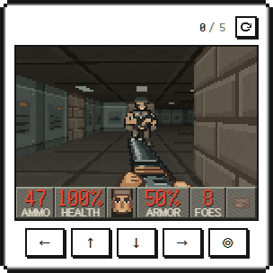</td>
    <td>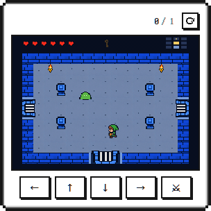</td>
  </tr>
  <tr><th>🏎️ レース</th><th>🚀 宇宙シューティング</th></tr>
  <tr>
    <td>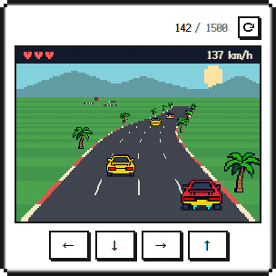</td>
    <td>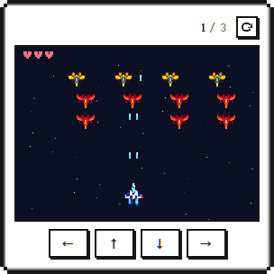</td>
  </tr>
  <tr><th>🧱 テトリス</th><th>🔢 2048</th></tr>
  <tr>
    <td>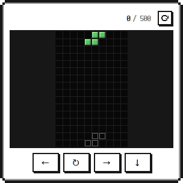</td>
    <td>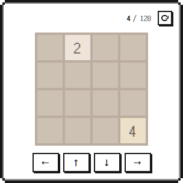</td>
  </tr>
  <tr><th>💣 マインスイーパー</th><th>🎾 ブロック崩し</th></tr>
  <tr>
    <td>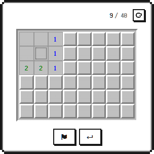</td>
    <td>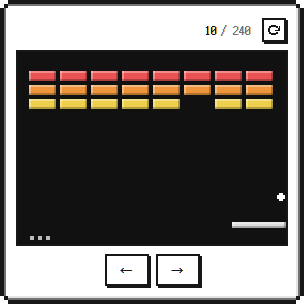</td>
  </tr>
  <tr><th>🐍 スネーク</th><th>👻 パックマン</th></tr>
  <tr>
    <td>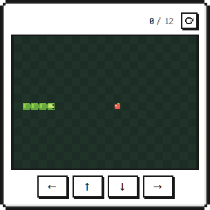</td>
    <td>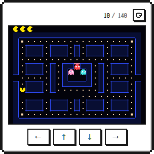</td>
  </tr>
  <tr><th>📦 倉庫番</th><th>🫧 バブルシューター</th></tr>
  <tr>
    <td>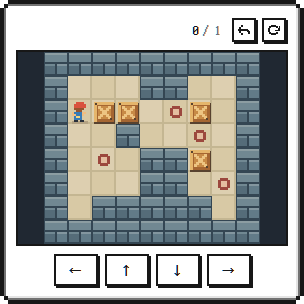</td>
    <td>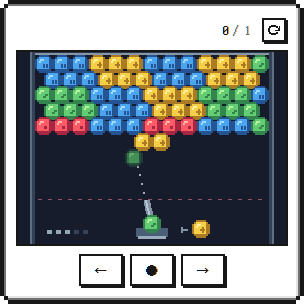</td>
  </tr>
</table>

収録ゲーム：テトリス、2048、マインスイーパー、ブロック崩し、FPS、冒険、レース、スネーク、宇宙シューティング、パックマン、倉庫番、バブルシューター。

> 娯楽用のフロントエンドの通過条件であり、ボット検出や認証サービスではありません。クリアイベントにセキュリティ上の保証はありません。実際のアクセス権限はサーバー側で制御してください。

## 🏁 ローカルで起動

Node.js **22.12 以降**（Node 22 LTS の最新パッチ版を推奨）と npm が必要です。ローカルのソースがある場合は `npm ci` から始めてください。

```sh
git clone https://github.com/superwyh/Arcade-CAPTCHA.git arcade-captcha
cd arcade-captcha
npm ci
npm run dev
```

`http://127.0.0.1:4173/` を開きます。開発サーバーとビルドのプレビューは同じ固定ポートを使い、使用中の場合はエラーになります。

Windows では [`start-demo.cmd`](start-demo.cmd) をダブルクリックしても起動できます。依存関係がなければインストールし、サーバーを起動してブラウザーを開きます。利用中はコマンドウィンドウを開いたままにし、終了時に閉じてください。

プレイグラウンドの機能：

- 12 種類のゲームを直接切り替え、ゲーム別の目標設定、初期値への復元、ランダムモード。
- 実際のウィジェットサイズでのプレビュー、スコア、リトライ。
- 読み込み・リセット後に即座に開始し、クリア後にページへ進むボタンを有効化。
- 現在の設定から JavaScript / HTML の組み込みコードと、コピー可能な AI 向け組み込みプロンプトを生成。API 設定は必要に応じて展開できます。

独立したログインデモ：`http://127.0.0.1:4173/examples/login.html`。初期言語は英語です。入力済みのデモアカウントで Sign in を押すと、毎回ランダムなゲームが開きます。同じゲームが連続することはありません。クリア後に模擬ログインが完了し、認証情報の送信・保存は行いません。日本語は `?lang=ja`、ブラウザーに合わせる場合は `?lang=auto` を指定します。

## 🎮 初期ルール

| ゲーム ID | ゲーム | 初期目標 | スコア・進捗の計算 | 設定範囲 |
| --- | --- | --- | --- | --- |
| `tetris` | テトリス | 500 点 | 1 / 2 / 3 / 4 行同時消去で 100 / 300 / 500 / 800 点 | 1–10000 |
| `2048` | 2048 | 128 点 | 合体後の数字を加算。最大タイルではなく累計スコアが目標 | 1–10000 |
| `minesweeper` | マインスイーパー | 安全な 40 マスをすべて開く | 開いた安全マスごとに 1。空白の自動展開も含む | 1–40 |
| `breakout` | ブロック崩し | 全 24 ブロックを破壊（240 点） | 1 ブロック 10 点、残機 3 | 1–240 |
| `fps` | FPS | 5 セクター、約 5–7 分 | 敵を倒し、赤い鍵を取り、出口に到達すると 1。敵を倒すだけでは通過しない | 1–5 |
| `adventure` | 冒険 | ダンジョンを 1 つクリア | 鍵を取り、守護者を倒し、出口の階段に到達すると 1 | 1–3 |
| `racing` | レース | 1500 メートル | 生き残ってゴールする | 1–10000 |
| `snake` | スネーク | エサを 12 個食べる | エサ 1 個で進捗が 1 増え、体が 1 マス伸びる | 1–100 |
| `space` | 宇宙シューティング | 3 ステージ：敵編隊 2 波とボス | ステージのクリアごとに 1。最終ステージは必ずボス | 1–5 |
| `pacman` | パックマン | 全 140 個のドットを集める | 通常ドットとパワードットは各 1。ゴーストを食べても進捗は増えない | 1–140 |
| `sokoban` | 倉庫番 | 1 面クリア | すべての箱を目標地点に置くと 1。複数面の連続クリアを設定可能 | 1–5 |
| `bubbles` | バブルシューター | 盤面を 1 つ全消去 | 盤面全体を消すと 1。個々のグループ消去では通過しない | 1–5 |

マインスイーパーとブロック崩しは、初期設定では全消去が必要です。開発者が目標を下げた場合は `score >= targetScore` で通過します。例えばブロック崩しの目標が 15 点なら、2 個の破壊で通過します。マインスイーパーは 8×6 の盤面に地雷が 8 個。最初のクリックと周囲は安全ですが、初手で安全マスがすべて開くことはありません。空白は通常のルールで展開します。テトリスは全 7 種類が 1 回ずつ入る七種一巡方式です。

キーボード操作はウィジェット内だけで有効になり、ページ全体の方向キーを奪いません。バックグラウンドのタブでは自動停止し、戻ると再開します。スマートフォンではボタン、スワイプ、タップ、ドラッグで操作できます。

### FPS

プレイグラウンドで `FPS` を選ぶか、`/?game=fps` を開きます。組み込みには `game: 'fps'` を指定します。`targetScore` はクリアするセクター数で、初期値は 5、範囲は 1–5。各プレイ・各セクターで 25×25 のマップを生成し、7–9 個のつながった部屋、分岐、環状通路、敵、補給品、鍵、出口を配置します。

W/S または上下キーで前進・後退、A/D または左右キーで旋回、Q/E で平行移動。画面内でマウスを動かすと旋回し、クリックでポインターロック、Esc で解除します。スペース、Enter、クリックで射撃。スマートフォンではドラッグ旋回と方向・射撃ボタンを利用できます。弾切れ時は近接攻撃が可能です。敵を全滅させ、赤い鍵を取ると出口が開きます。バックグラウンド移行、フォーカス喪失、リトライ、ゲーム切り替え時には押下状態とポインターロックを解除します。

Canvas レイキャスティングと合成効果音を使用します。音声は最初の操作後に有効になり、ゲームを離れると解放します。

### 冒険

「冒険」を選ぶか、`/?game=adventure` を開きます。`game: 'adventure'` で組み込み、初期値 `targetScore: 1` を 1–3 ダンジョンに設定できます。

9 個のつながった部屋にスライム、コウモリ、骸骨、石の守護者が登場します。敵を倒すと扉や宝箱が開き、鍵、剣の強化、最大体力増加、回復を入手できます。鍵で守護者の部屋を開き、守護者を倒して階段に入るとクリア。ミニマップには現在の部屋と探索済みの範囲を表示します。

WASD / 方向キーで移動、スペース / J / Enter で攻撃。画面をクリック・長押しで攻撃、ドラッグで移動します。タッチ用の方向・攻撃ボタンもあります。物理キーの認識とフォーカス喪失時の入力解除に対応します。

素材：[キャラクターアニメーション](src/assets/adventure-hero.png)、[ダンジョンのアトラス](src/assets/adventure-dungeon.png)、[素材仕様と出典](src/assets/adventure-art.txt)。

### レース

「レース」を選ぶか、`/?game=racing` を開きます。`game: 'racing'` で組み込みます。初期目標は 1500 メートル、範囲は 1–10000。自動で前進し、3 回衝突すると終了します。カーブと交通車両はランダムに変化し、初期コースは約 1 分です。

A/D または左右キーで操舵、S/下キーでブレーキ、W/上キー/スペースで加速。ドラッグとタッチボタンにも対応します。道路を外れると減速し、2 秒間外れたままだと残機を 1 つ失います。リトライすると新しいコースを生成します。

素材：[車両アトラス](src/assets/racing-atlas.png)、[素材仕様と出典](src/assets/racing-art.txt)。

### スネーク

「スネーク」を選ぶか、`/?game=snake` を開きます。`game: 'snake'` で組み込みます。初期値 `targetScore: 12` はエサ 1–100 個に変更できます。22×16 の盤面で自動移動し、食べるほど長く、速くなります。壁や自分の体にぶつかると終了。エサは空きマスにだけ出現します。

方向キー、WASD、スワイプ、タッチボタンで方向転換します。真後ろへの反転はできず、連続入力は順番に処理します。中国語 IME 使用中も物理キーで操作できます。緑のヘビと赤いエサは Canvas で描画し、画像アセットは不要です。

### 宇宙シューティング

宇宙シューティングを選ぶか、`/?game=space` を開きます。`game: 'space'` で組み込みます。初期値 `targetScore: 3` は敵編隊 2 波とボス。1–5 ステージに設定でき、最終ステージは必ずボスです。1 を指定するとボス戦から始まります。編隊全体の撃破またはボス撃破でのみ進捗が増えます。

自動で開始し、連続射撃します。方向キー、WASD、ドラッグ、タッチボタンで移動し、中国語 IME 使用中も物理キーで操作できます。残機は 3、被弾後には短い無敵時間があります。ステージ間で敵弾を消し、残機を 1 回復します。離脱時に入力状態を解放し、リトライすると敵の攻撃タイミングを再生成します。

素材：[宇宙シューティングのアトラス](src/assets/space-atlas.png)、[素材仕様と出典](src/assets/space-art.txt)。

### パックマン

「パックマン」を選ぶか、`/?game=pacman` を開きます。`game: 'pacman'` で組み込みます。初期目標はパワードット 4 個を含む全 140 個のドット。`targetScore` は 1–140 に設定できます。ゴーストを食べても認証の進捗は増えません。

21×15 の迷路、残機 3。方向キー、WASD、スワイプ、タッチボタンで曲がります。曲がる方向の先行入力と移動中の反転に対応し、左右のトンネルはつながっています。パワードットの効果は 7 秒間で、食べられたゴーストは出現地点に戻ります。被弾後も取得済みドットは維持し、復活直後には短い無敵時間があります。リトライすると迷路全体をリセットします。

### 倉庫番

「倉庫番」を選ぶか、`/?game=sokoban` を開きます。`game: 'sokoban'` で組み込みます。初期目標は 1 面、`targetScore` で連続 1–5 面を指定できます。[Boxoban の難問セット](https://github.com/google-deepmind/boxoban-levels)から 5 面を収録。各面に箱が 4 個あり、最小押し回数は順に 27、20、21、20、19 回です。箱を押す順序、一時的な移動、回り込みを考える必要があります。すべての箱を目標地点に置くと進捗が増え、移動、押す操作、取り消し自体には加点しません。

方向キー、WASD、スワイプ、タッチボタンで移動。Z または上部の取り消しアイコンで、箱を押した操作も含めて 1 手戻せます。中国語 IME 使用中も物理キーで操作できます。箱は一度に 1 個だけ押せて、引くことはできません。動かせなくなったら取り消しやリトライを使います。クリア後は自動で次の面へ進み、取り消しは現在の面にのみ有効です。リトライは最初の面からやり直します。

レベルは Arthur Guez らの Boxoban データセットを使用し、Apache 2.0 ライセンスに従います。外周の壁だけを切り取り、2 面を転置して表示サイズに合わせました。元のレベル、出典、ライセンス全文は [third-party/boxoban/](third-party/boxoban/) に保存し、ビルド時に `lib/licenses/` と `dist/licenses/` に同梱します。

### バブルシューター

バブルシューターを選ぶか、`/?game=bubbles` を開きます。`game: 'bubbles'` で組み込みます。初期目標は盤面 1 つの全消去で、`targetScore` を 1–5 盤面に設定できます。4 色のバブルをランダムに配置し、同色が 3 個以上つながるとグループごと消え、天井から切り離されたバブルも落下します。最初は 5 行 63 個、3 盤面目から 6 行になります。

マウス、タッチドラッグ、A/D、左右キーで照準を合わせます。クリック／指を離す操作、スペース、Enter、発射ボタンで発射。点線は反射経路と着地点を示し、隣に次のバブルを表示します。盤面に残っている色だけが供給され、同時に飛ぶバブルは 1 個です。5 回連続で消せないと天井が 1 行下がり、消去に成功すると回数がリセットされます。バブルが下端に達すると終了。リトライで盤面と進捗をリセットします。

## 言語とフォント

ウィジェットとプレイグラウンドは `navigator.languages` の優先順位に従い、簡体字中国語、繁体字中国語、英語、日本語、韓国語、フランス語、ドイツ語、スペイン語、ポルトガル語を選択します。非対応言語は英語にフォールバックします。`zh-Hant`、`zh-TW`、`zh-HK`、`zh-MO` は繁体字、`zh-Hans` は簡体字です。`fr-CA` や `pt-BR` は対応する基本言語に一致します。

`locale: 'ja'` を渡すか、`reset({ locale: 'ja' })` で言語を変更できます。`getGames(locale)` は翻訳済みのゲーム名を返します。プレイグラウンドも `?lang=ja` などに対応し、指定がなければブラウザーに従います。

Fusion Pixel 12px はこれらの言語をカバーし、CDN を使わずローカルから読み込みます。[SIL OFL 1.1](third-party/fusion-pixel/OFL.txt) に基づき、無料利用、商用利用、再配布が可能です。`lib/licenses/` 内のフォントと上流のライセンスを保持してください。使用リリースは `v2026.11.10`、提供元は [TakWolf/fusion-pixel-font](https://github.com/TakWolf/fusion-pixel-font)。`lib/fonts/` をコンポーネントと共に配置します。

## ビルドとテスト

```sh
npm test            # ゲームルールと認証ライフサイクルのテスト
npm run typecheck   # TypeScript のチェック
npm run build       # デモ、配布用コンポーネント、型宣言
npm run preview     # http://127.0.0.1:4173 で dist をプレビュー
```

- `dist/`：静的デモサイト。`examples/basic.html` と必要な `lib/` を含みます。
- `lib/arcade-captcha.js`：ES Module コンポーネント。
- `lib/arcade-captcha.umd.cjs`：グローバル名 `ArcadeCaptcha` の UMD ビルド。
- `lib/arcade-captcha.css`：必須のコンポーネントスタイル。
- `lib/index.d.ts`：完全な型宣言。

ビルド成果物は Git にコミットせず、CI で再生成します。リモートフォント、画像 CDN、バックエンドサービスへの依存はありません。

## HTML への組み込み

上記 URL から clone し、`npm ci` と `npm run build:lib` を実行します。`fonts/` と `licenses/` を含む `lib/` 全体をアプリの静的アセットにコピーしてください。以下のパスは HTML ファイルからの相対パスです。配置に合わせて調整し、HTTP サーバーで開いてください。HTML をダブルクリックして `file://` で ES Module を読み込むことはできません。[`examples/basic.html`](examples/basic.html) は `npm run dev` 後に `/examples/basic.html` で実行できます。

```html
<link rel="stylesheet" href="./lib/arcade-captcha.css" />
<div id="captcha"></div>
<button id="enter" disabled>ページへ進む</button>

<script type="module">
  import { createCaptcha } from './lib/arcade-captcha.js';

  const enter = document.querySelector('#enter');
  const gate = createCaptcha('#captcha', {
    game: 'tetris',
    targetScore: 500,
    onStateChange({ state }) {
      // リトライやゲーム変更時には前回の通過状態を解除します。
      enter.disabled = state !== 'passed';
    },
    onVerify(result) {
      console.log(result.game, result.score, result.durationMs);
    },
  });

  enter.addEventListener('click', () => {
    if (gate.getSnapshot().state === 'passed') {
      // 実際の URL に変更し、アクセス権限はサーバー側で制御してください。
      window.location.assign('./welcome.html');
    }
  });
</script>
```

## Vite / React / Vue への組み込み

npm パッケージはまだ公開していません。clone 後に `npm ci` と `npm run build:lib` を実行し、利用側のプロジェクトで `npm install /absolute/path/to/arcade-captcha` を実行します。パスはローカルの clone 先に置き換えてください。その後、以下のパッケージ名で import できます。`lib/` 全体を静的ディレクトリに置き、HTML の例で読み込むことも可能です。

```ts
import { createCaptcha } from 'arcade-captcha';
import 'arcade-captcha/style.css';

const gate = createCaptcha(element, {
  game: 'random',
  targets: { tetris: 500, '2048': 128, minesweeper: 40, breakout: 240, fps: 5, adventure: 1, racing: 1500, snake: 12, space: 3, pacman: 140, sokoban: 1, bubbles: 1 },
  onVerify(result) {
    // アプリの通過状態を更新します。
  },
  onStateChange({ state }) {
    // state !== 'passed' の場合は通過状態を解除します。
  },
});

// React の effect cleanup / Vue の onBeforeUnmount で呼び出します。
gate.destroy();
```

React では `useEffect` 内で `ref.current` にマウントし、`() => gate.destroy()` を返します。Vue では `onMounted` で作成し、`onBeforeUnmount` で解放します。同じページで複数の独立したインスタンスを使えます。

### 必要なゲームだけを読み込む

既定の `arcade-captcha` は引き続き全12ゲームを登録します。`arcade-captcha/core` と個別のゲームエントリーを使うと、不要なゲームや画像を読み込まずに済みます。

```ts
import { createCaptcha, registerGame } from 'arcade-captcha/core';
import { tetrisGame } from 'arcade-captcha/games/tetris';
import 'arcade-captcha/style.css';

registerGame(tetrisGame);
const gate = createCaptcha(element, { game: 'tetris' });
```

個別エントリーは `tetrisGame` や `fpsGame` などの定義を公開します。2048 は `arcade-captcha/games/2048` の `mergeGame` です。ウィジェットの作成前に各定義を一度だけ登録してください。この場合、`random` は登録済みのゲームだけから選びます。両エントリーは登録情報を共有するため、全ゲームのエントリーを読み込んだ後に組み込みゲームを再登録しないでください。通常の HTML では `./lib/core.js` と `./lib/games/tetris.js` を使い、CSS は別途読み込みます。`chunks/`、`games/`、`fonts/`、`licenses/` を含む `lib/` 全体を保持してください。

元画像は `src/assets/` に保持します。ビルドとテストは `npm run prepare:assets` を実行し、最近傍補間で小さな実行用アトラスを生成します。生成された `src/assets/runtime/` は直接編集しないでください。

初回に `npx playwright install chromium` を実行し、続いて `npm run test:browser` を実行します。本番ビルドに加え、狭い画面、キーボードフォーカス、ダイアログのキャンセル、ゲーム切り替え、画像のピクセル一致を確認します。スクリーンショットと trace は `.qa/browser-results/` に出力されます。インストール済みの Chrome を使う場合は環境変数 `PLAYWRIGHT_CHANNEL=chrome` を設定してください。

### 設定とライフサイクル

| 設定 | 初期値 | 説明 |
| --- | --- | --- |
| `game` | `'tetris'` | 登録済みのゲーム ID、または `'random'` |
| `locale` | `'auto'` | ブラウザーに合わせるか、`ja`、`fr-CA` などを指定 |
| `autoStart` | `true` | マウント、切り替え、リセット後に即座に開始。手動制御は `false` |
| `targetScore` | 現在のゲームの初期値 | ゲームの上限以下の正の整数 |
| `targets` | なし | ゲーム別の目標。`targetScore` より優先 |
| `onVerify(result)` | なし | 1 回のプレイにつき最大 1 回。通過後はゲームを停止 |
| `onStateChange(snapshot)` | なし | 状態・スコアの変化時と初期化時に呼び出す |

`random` は登録済みの全ゲームから選びます。リセットで再抽選し、同じゲームが続くこともあります。ランダムモードでは `targets` を推奨します。共通の `targetScore` は候補の全ゲームで有効な値である必要があり、そうでなければ `RangeError` になります。

インスタンスメソッド：`start()`、`pause()`、`resume()`、`reset(partialOptions?)`、`getSnapshot()`、`destroy()`。初期設定ではマウント直後に `running` となり、開始ボタンは不要です。`autoStart: false` のときだけ `idle` で待機します。

状態遷移：`idle → running → passed / failed`、`running ⇄ paused`。`reset()` は進捗を消去し、`autoStart` に従って開始または待機します。渡した設定は既存設定にマージされ、解除する場合は `targetScore: undefined` や `targets: undefined` を明示します。`destroy()` はアニメーション、イベント、DOM を解放し、以後そのインスタンスは使えません。

```ts
interface VerificationResult {
  game: string;
  score: number;
  targetScore: number;
  durationMs: number;   // 一時停止を除くプレイ時間
  completedAt: string; // ISO 8601 の日時
}

interface CaptchaSnapshot {
  state: 'idle' | 'running' | 'paused' | 'passed' | 'failed';
  game: string;
  score: number;
  targetScore: number;
}
```

### ゲームの追加

`GameDefinition` を実装し、`registerGame(definition)` を呼び出します。完全な型は [`src/types.ts`](src/types.ts)、既存実装は [`src/games/`](src/games/) を参照してください。

```ts
import { registerGame, type GameDefinition } from 'arcade-captcha';

const customGame: GameDefinition = {
  id: 'your-game',
  name: '自作ゲーム',
  description: 'ゲームの説明',
  instructions: '操作方法',
  defaultTarget: 10,
  maxTarget: 100,
  scoreUnit: '点',
  controls: [{ action: 'reveal', symbol: '↵', label: '実行' }],
  create({ surface, reportScore, fail, announce }) {
    // surface 内にゲームを描画します。
    // reportScore(totalScore); fail('理由'); announce('状態');
    return {
      start() {},
      pause() {},
      resume() {},
      action(action) {},
      destroy() {},
    };
  },
};
registerGame(customGame);
```

追加ゲームは一時停止と解放処理を実装し、アクセス許可を直接決定しません。フレームワークが目標検証、1 回限りの通過コールバック、古いセッションの分離を担当します。同じ ID の重複登録はエラーです。リアルタイムゲームは `GameDefinition.keys` でキーを割り当て、任意の `setInput(action, pressed)` メソッドで押下・解放を受け取れます。フォーカス喪失、一時停止、リセット時にキーを解放します。未実装のゲームは `action()` を使います。

## GitHub とデプロイ

リポジトリ：`https://github.com/superwyh/Arcade-CAPTCHA`。Pages：`https://superwyh.github.io/Arcade-CAPTCHA/`。Vite は `base: './'` の相対アセットパスを使い、ルートサイトと `https://<user>.github.io/<repository>/` の両方に対応します。リポジトリ名の固定記述は不要です。

1. ソースと `package-lock.json` を GitHub の `main` または `master` に push します。
2. **Settings → Pages → Build and deployment → Source** で **GitHub Actions** を選びます。
3. push するか、Actions で **Deploy demo to GitHub Pages** を手動実行します。
4. 依存関係のインストール、テスト、型チェック、ビルド後に `dist/` を Pages へ配置します。
5. URL はワークフローの `github-pages` 環境で確認できます。初回はリポジトリ設定で Pages を有効にしてください。

`.github/workflows/ci.yml` はプルリクエストを検証します。`pages.yml` は `main` / `master` への push または手動実行でデプロイし、プルリクエストを直接公開しません。デプロイジョブには Pages と OIDC に必要な権限だけを付与します。データベース、API キー、追加のシークレットは不要です。

ライセンス：[MIT](LICENSE)。貢献ガイド：[CONTRIBUTING.md](CONTRIBUTING.md)。セキュリティ上の範囲：[SECURITY.md](SECURITY.md)。

## ディレクトリ構成

```text
src/core.ts            登録、ライフサイクル、目標判定、通過コールバック
src/types.ts           ゲーム拡張と公開 API の型
src/games/             12 種類のゲームのロジックと描画
src/style.css          組み込みコンポーネント専用のスタイル
demo/                 設定用プレイグラウンドとデモの完了ページ
examples/basic.html   最小の HTML 組み込み例
tests/                ゲームルールとフレームワークの回帰テスト
.github/workflows/    CI と GitHub Pages のデプロイ
```
