# 🕹️ Arcade CAPTCHA

[English](README.md) · [简体中文](README.zh-CN.md) · [日本語](README.ja.md) · 한국어

미니게임을 완료하면 통과하는 CAPTCHA 컴포넌트입니다. 픽셀 게임 12종, 목표 설정, 무작위 게임 선택, 9개 언어를 지원합니다. TypeScript로 작성했으며 런타임 의존성이 없습니다. HTML, React, Vue에 삽입할 수 있습니다.

[GitHub](https://github.com/superwyh/Arcade-CAPTCHA) · [데모](https://superwyh.github.io/Arcade-CAPTCHA/)

<table>
  <tr><th>🎯 FPS</th><th>⚔️ 모험</th></tr>
  <tr>
    <td>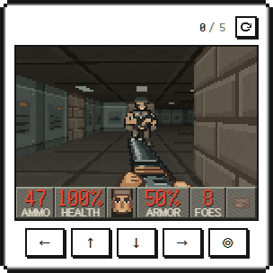</td>
    <td>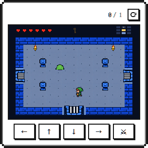</td>
  </tr>
  <tr><th>🏎️ 레이싱</th><th>🚀 우주 슈팅</th></tr>
  <tr>
    <td>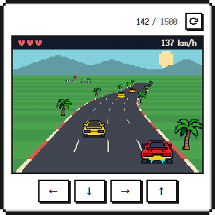</td>
    <td>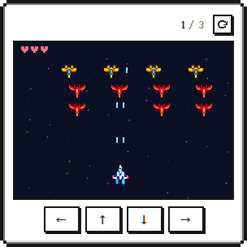</td>
  </tr>
  <tr><th>🧱 테트리스</th><th>🔢 2048</th></tr>
  <tr>
    <td>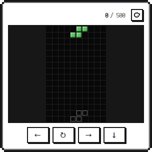</td>
    <td>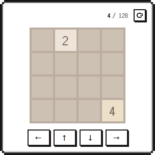</td>
  </tr>
  <tr><th>💣 지뢰찾기</th><th>🎾 벽돌깨기</th></tr>
  <tr>
    <td>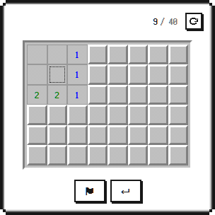</td>
    <td>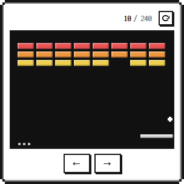</td>
  </tr>
  <tr><th>🐍 스네이크</th><th>👻 팩맨</th></tr>
  <tr>
    <td>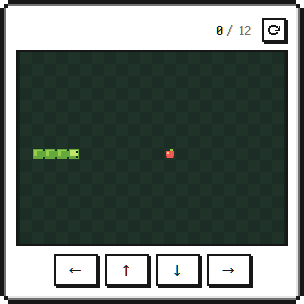</td>
    <td>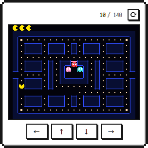</td>
  </tr>
  <tr><th>📦 소코반</th><th>🫧 버블 슈터</th></tr>
  <tr>
    <td>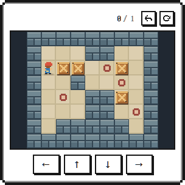</td>
    <td>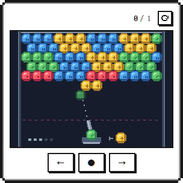</td>
  </tr>
</table>

게임: 테트리스, 2048, 지뢰찾기, 벽돌깨기, FPS, 모험, 레이싱, 스네이크, 우주 슈팅, 팩맨, 소코반, 버블 슈터.

> 오락용 프런트엔드 통과 조건이며 봇 탐지나 인증 서비스가 아닙니다. 완료 이벤트는 보안을 보장하지 않습니다. 실제 접근 권한은 서버에서 제어해야 합니다.

## 🤖 AI 통합 프롬프트

아래 내용을 복사해 코딩 도우미에게 전달하세요.

```text
Arcade CAPTCHA를 이 프로젝트의 기존 로그인, 제출 또는 입장 흐름에 통합하세요. 현재 프레임워크와 페이지 구조를 유지하면서 코드를 직접 수정하세요.

저장소와 API 문서: https://github.com/superwyh/Arcade-CAPTCHA#readme
데모: https://superwyh.github.io/Arcade-CAPTCHA/?view=login

Git과 Node.js 22.12 이상을 사용해 별도의 작업 디렉터리에서 실행하세요:
git clone https://github.com/superwyh/Arcade-CAPTCHA.git arcade-captcha
cd arcade-captcha
npm ci
npm run build:lib

생성된 lib/ 전체를 이 프로젝트의 정적 파일 디렉터리에 복사하고 chunks/, games/, fonts/, licenses/를 유지하세요. 실제 배포 경로에 맞춰 arcade-captcha.css를 불러오고 arcade-captcha.js에서 createCaptcha를 가져오세요. 브라우저에서만 초기화하며 npm 배포에 의존하지 마세요.

createCaptcha(container, { game: 'random', locale: 'auto', autoStart: true, onStateChange })를 마운트하세요. 각 게임의 기본 목표, 픽셀 테두리, 자동 시작을 유지하세요.

onStateChange({ state })로 state === 'passed'일 때만 기존 작업을 진행하세요. 재시도 시 다시 잠그고 제출 전에 gate.getSnapshot().state를 확인하세요. 기존 서버 인증과 검증은 유지하고 컴포넌트나 경로를 해제할 때 gate.destroy()를 호출하세요.

구현을 완료하고 통과, 재시도, 키보드·터치 조작, 프로덕션 빌드를 검증하세요. 관련 없는 UI나 문구는 추가하지 마세요.
```

## 🏁 로컬 실행

Node.js **22.12 이상**(Node 22 LTS의 최신 패치 버전 권장)과 npm이 필요합니다. 로컬 소스가 있다면 `npm ci`부터 실행하세요.

```sh
git clone https://github.com/superwyh/Arcade-CAPTCHA.git arcade-captcha
cd arcade-captcha
npm ci
npm run dev
```

`http://127.0.0.1:4173/`을 엽니다. 개발 서버와 빌드 미리보기는 같은 고정 포트를 사용하며, 이미 사용 중이면 오류를 표시합니다.

Windows에서는 [`start-demo.cmd`](start-demo.cmd)를 더블 클릭해도 됩니다. 의존성이 없으면 설치하고, 로컬 서버와 브라우저를 실행합니다. 사용 중에는 명령 창을 열어 두고, 서버를 종료하려면 창을 닫으세요.

테스트 페이지 기능:

- 게임 12종을 직접 전환하고, 게임별 목표 설정, 기본값 복원, 무작위 모드 사용.
- 실제 위젯 크기로 미리보기, 점수 확인, 재시도.
- 로드하거나 초기화하면 즉시 시작하고, 완료하면 페이지 진입 버튼 활성화.
- 현재 설정에 맞는 JavaScript / HTML 삽입 코드와 복사 가능한 AI용 삽입 프롬프트 생성. API 설정은 필요할 때 펼칠 수 있습니다.

로그인 데모는 메인 페이지에 포함되어 있습니다. **로그인 데모**를 누르거나 `http://127.0.0.1:4173/?view=login`을 여세요. 페이지와 같은 언어를 사용합니다. 미리 입력된 데모 계정으로 로그인하면 매번 무작위 게임이 열리며 같은 게임이 연속으로 나오지 않습니다. 통과하면 모의 로그인이 완료되고 계정 정보는 전송하거나 저장하지 않습니다. **테스트로 돌아가기**를 누르면 이전 게임과 목표 설정으로 돌아갑니다.

## 🎮 기본 규칙

| 게임 ID | 게임 | 기본 목표 | 점수 및 진행도 계산 | 설정 범위 |
| --- | --- | --- | --- | --- |
| `tetris` | 테트리스 | 500점 | 1 / 2 / 3 / 4줄 동시 제거 시 100 / 300 / 500 / 800점 | 1–10000 |
| `2048` | 2048 | 128점 | 합쳐진 타일의 값을 더함. 가장 큰 타일이 아닌 누적 점수가 목표 | 1–10000 |
| `minesweeper` | 지뢰찾기 | 안전한 40칸 모두 열기 | 열린 안전 칸마다 1. 빈 영역 자동 확장도 포함 | 1–40 |
| `breakout` | 벽돌깨기 | 벽돌 24개 모두 제거(240점) | 벽돌당 10점, 목숨 3개 | 1–240 |
| `fps` | FPS | 구역 5개, 약 5–7분 | 적을 모두 처치하고 빨간 열쇠를 얻어 출구에 도착하면 1. 적 처치만으로는 통과하지 않음 | 1–5 |
| `adventure` | 모험 | 던전 1개 완료 | 열쇠를 얻고 수호자를 처치한 뒤 출구 계단에 도착하면 1 | 1–3 |
| `racing` | 레이싱 | 1500미터 | 살아남아 결승선 통과 | 1–10000 |
| `snake` | 스네이크 | 먹이 12개 | 먹이마다 진행도 1 증가, 몸이 한 칸씩 늘어남 | 1–100 |
| `space` | 우주 슈팅 | 적 편대 2회와 보스, 총 3단계 | 단계를 완료할 때마다 1. 마지막 단계는 항상 보스 | 1–5 |
| `pacman` | 팩맨 | 점 140개 모두 수집 | 일반 점과 파워 점은 각각 1. 유령을 먹어도 진행도는 증가하지 않음 | 1–140 |
| `sokoban` | 소코반 | 레벨 1개 완료 | 모든 상자를 목표 지점에 놓아야 1. 여러 레벨 연속 완료 설정 가능 | 1–5 |
| `bubbles` | 버블 슈터 | 보드 1개 전체 제거 | 보드를 모두 비워야 1. 개별 그룹 제거만으로는 통과하지 않음 | 1–5 |

지뢰찾기와 벽돌깨기는 기본적으로 전체 완료가 필요합니다. 개발자가 목표를 낮추면 `score >= targetScore`일 때 통과합니다. 예를 들어 벽돌깨기 목표가 15점이면 벽돌 2개를 제거하면 됩니다. 지뢰찾기는 8×6 보드와 지뢰 8개를 사용합니다. 첫 클릭과 주변 칸은 안전하지만, 첫 클릭에 모든 안전 칸이 열리지는 않습니다. 빈 영역은 일반 지뢰찾기 규칙에 따라 확장됩니다. 테트리스는 일곱 종류의 블록이 한 번씩 나오는 7백 방식으로 생성합니다.

키보드 조작은 위젯 안에서만 적용되며 페이지 전체의 방향키를 가로채지 않습니다. 백그라운드 탭으로 전환하면 자동으로 멈추고, 돌아오면 재개합니다. 모바일에서는 버튼, 스와이프, 탭, 드래그를 사용할 수 있습니다.

### FPS

테스트 페이지에서 `FPS`를 선택하거나 `/?game=fps`를 엽니다. 삽입할 때는 `game: 'fps'`를 사용합니다. `targetScore`는 완료할 구역 수로, 기본값은 5이며 1–5로 설정할 수 있습니다. 매 플레이와 구역마다 25×25 맵을 생성하며, 연결된 방 7–9개, 갈림길, 순환 통로, 적, 보급품, 열쇠, 출구를 배치합니다.

W/S 또는 위/아래 방향키로 전진·후진, A/D 또는 좌우 방향키로 회전, Q/E로 옆걸음을 합니다. 게임 화면에서 마우스를 움직이면 회전하고, 클릭하면 포인터를 잠급니다. Esc로 잠금을 해제합니다. 스페이스, Enter, 클릭으로 사격합니다. 모바일은 드래그 회전과 방향·사격 버튼을 지원합니다. 탄약이 떨어지면 근접 공격을 할 수 있습니다. 적을 모두 처치하고 빨간 열쇠를 얻으면 출구가 열립니다. 백그라운드 전환, 포커스 상실, 재시도, 게임 변경 시 누른 키와 포인터 잠금을 해제합니다.

Canvas 레이캐스팅과 합성 효과음을 사용합니다. 오디오는 첫 조작 후 활성화되며 게임을 떠나면 정리합니다.

### 모험

모험을 선택하거나 `/?game=adventure`를 엽니다. `game: 'adventure'`로 삽입하며, 기본값 `targetScore: 1`을 던전 1–3개로 설정할 수 있습니다.

연결된 방 9개에 슬라임, 박쥐, 해골, 돌 수호자가 등장합니다. 적을 처치하면 문과 보물 상자가 열립니다. 상자에서 열쇠, 검 강화, 최대 체력 증가, 회복을 얻을 수 있습니다. 열쇠로 수호자 방을 열고, 수호자를 처치한 뒤 계단에 들어가면 완료됩니다. 미니맵은 현재 방과 탐험한 구역을 표시합니다.

WASD / 방향키로 이동하고 스페이스 / J / Enter로 공격합니다. 화면을 클릭하거나 누르고 있으면 공격하며, 드래그로 이동합니다. 터치용 방향·공격 버튼도 있습니다. 물리 키 인식과 포커스를 잃었을 때 입력 해제를 지원합니다.

리소스: [캐릭터 애니메이션](src/assets/adventure-hero.png), [던전 아틀라스](src/assets/adventure-dungeon.png), [리소스 사양 및 출처](src/assets/adventure-art.txt).

### 레이싱

레이싱을 선택하거나 `/?game=racing`을 엽니다. `game: 'racing'`으로 삽입합니다. 기본 목표는 1500미터이며 1–10000으로 설정할 수 있습니다. 차량은 자동으로 전진하며, 세 번 충돌하면 종료됩니다. 커브와 교통 차량은 무작위로 달라집니다. 기본 코스는 약 1분입니다.

A/D 또는 좌우 방향키로 조향하고, S/아래 방향키로 제동하며, W/위 방향키/스페이스로 가속합니다. 드래그와 터치 버튼도 지원합니다. 도로를 벗어나면 느려지고, 2초 동안 벗어나 있으면 목숨을 하나 잃습니다. 재시도하면 새 코스를 생성합니다.

리소스: [차량 아틀라스](src/assets/racing-atlas.png), [리소스 사양 및 출처](src/assets/racing-art.txt).

### 스네이크

스네이크를 선택하거나 `/?game=snake`를 엽니다. `game: 'snake'`로 삽입합니다. 기본값 `targetScore: 12`는 먹이 1–100개로 설정할 수 있습니다. 22×16 보드에서 자동으로 이동하며 먹을수록 길어지고 빨라집니다. 벽이나 자신의 몸에 부딪히면 종료됩니다. 먹이는 빈 칸에만 나타납니다.

방향키, WASD, 스와이프, 터치 버튼으로 방향을 바꿉니다. 정반대 방향으로 바로 돌 수 없으며, 연속 입력은 순서대로 처리합니다. 중국어 입력기 사용 중에도 물리 키로 조작할 수 있습니다. 초록색 뱀과 빨간 먹이는 Canvas로 그리며 별도 이미지가 필요하지 않습니다.

### 우주 슈팅

우주 슈팅을 선택하거나 `/?game=space`를 엽니다. `game: 'space'`로 삽입합니다. 기본값 `targetScore: 3`은 적 편대 두 차례와 보스전입니다. 1–5단계를 설정할 수 있으며, 마지막은 항상 보스전입니다. 1로 설정하면 바로 보스전에 들어갑니다. 편대를 전부 처치하거나 보스를 물리쳐야 진행도가 증가합니다.

자동으로 시작하고 연속 사격합니다. 방향키, WASD, 드래그, 터치 버튼으로 이동하며 중국어 입력기에서도 물리 키를 사용할 수 있습니다. 목숨은 3개이며, 피격 후 잠시 무적이 됩니다. 단계 사이에는 적 탄환을 지우고 목숨을 하나 회복합니다. 게임을 떠나면 입력 상태를 해제하며, 재시도하면 적 공격 타이밍을 다시 생성합니다.

리소스: [우주 슈팅 아틀라스](src/assets/space-atlas.png), [리소스 사양 및 출처](src/assets/space-art.txt).

### 팩맨

팩맨을 선택하거나 `/?game=pacman`을 엽니다. `game: 'pacman'`으로 삽입합니다. 기본 목표는 파워 점 4개를 포함한 점 140개 전부입니다. `targetScore`는 1–140으로 설정할 수 있습니다. 유령을 먹어도 인증 진행도는 증가하지 않습니다.

21×15 미로와 목숨 3개를 사용합니다. 방향키, WASD, 스와이프, 터치 버튼으로 방향을 바꿉니다. 미리 방향을 입력하거나 이동 중 반대로 돌 수 있으며, 좌우 터널은 연결되어 있습니다. 파워 점 효과는 7초이며, 먹힌 유령은 시작 위치로 돌아갑니다. 피격 후에도 수집한 점은 유지되고, 부활 직후에는 잠시 무적이 됩니다. 재시도하면 미로 전체를 초기화합니다.

### 소코반

소코반을 선택하거나 `/?game=sokoban`을 엽니다. `game: 'sokoban'`으로 삽입합니다. 기본 목표는 레벨 1개이며, `targetScore`로 연속 1–5개를 설정할 수 있습니다. [Boxoban 고난도 세트](https://github.com/google-deepmind/boxoban-levels)의 맵 5개를 사용합니다. 각 맵에는 상자가 4개 있으며 최소 밀기 횟수는 순서대로 27, 20, 21, 20, 19회입니다. 미는 순서, 상자의 임시 이동, 우회 경로를 고려해야 합니다. 모든 상자를 목표 지점에 놓아야 진행도가 증가하며, 이동, 밀기, 되돌리기 자체는 점수에 포함되지 않습니다.

방향키, WASD, 스와이프, 터치 버튼으로 이동합니다. Z 또는 상단 되돌리기 아이콘으로 상자 밀기를 포함해 한 수를 되돌릴 수 있습니다. 중국어 입력기에서도 물리 키를 사용할 수 있습니다. 상자는 한 번에 하나씩 밀 수 있고 당길 수는 없습니다. 막히면 되돌리거나 재시도하세요. 완료하면 다음 레벨로 자동 이동하며, 되돌리기는 현재 레벨에서만 적용됩니다. 재시도는 첫 레벨부터 시작합니다.

레벨은 Arthur Guez 등이 공개한 Boxoban 데이터셋을 사용하며 Apache 2.0 라이선스를 따릅니다. 바깥쪽 벽만 잘라내고 맵 2개의 행과 열을 바꾸어 표시 크기에 맞췄습니다. 원본 레벨, 출처, 라이선스 전문은 [third-party/boxoban/](third-party/boxoban/)에 보관하며, 빌드 시 `lib/licenses/`와 `dist/licenses/`에 포함합니다.

### 버블 슈터

버블 슈터를 선택하거나 `/?game=bubbles`를 엽니다. `game: 'bubbles'`로 삽입합니다. 기본 목표는 보드 1개 전체 제거이며, `targetScore`로 1–5개를 설정할 수 있습니다. 보드에는 네 가지 색의 버블이 무작위로 배치됩니다. 같은 색이 3개 이상 연결되면 그룹 전체가 사라지고, 천장과 연결이 끊긴 버블도 떨어집니다. 처음에는 5줄 63개이며, 세 번째 보드부터 6줄로 늘어납니다.

마우스, 터치 드래그, A/D, 좌우 방향키로 조준합니다. 클릭하거나 손을 떼기, 스페이스, Enter, 발사 버튼으로 쏩니다. 점선은 반사 경로와 도착 지점을 보여 주며, 옆에는 다음 버블이 표시됩니다. 보드에 남아 있는 색만 공급되고 한 번에 버블 하나만 날아갑니다. 5회 연속으로 제거하지 못하면 천장이 한 줄 내려오고, 제거에 성공하면 횟수가 초기화됩니다. 버블이 아래 경계에 닿으면 실패합니다. 재시도하면 보드와 진행도를 초기화합니다.

## 언어와 폰트

위젯과 테스트 페이지는 `navigator.languages`의 우선순위에 따라 중국어 간체, 중국어 번체, 영어, 일본어, 한국어, 프랑스어, 독일어, 스페인어, 포르투갈어를 선택합니다. 지원하지 않는 언어는 영어로 표시합니다. `zh-Hant`, `zh-TW`, `zh-HK`, `zh-MO`는 번체, `zh-Hans`는 간체를 사용합니다. `fr-CA`, `pt-BR` 등의 지역 태그는 해당 기본 언어에 연결됩니다.

`locale: 'ko'`를 전달하거나 `reset({ locale: 'ko' })`로 인스턴스 언어를 바꿀 수 있습니다. `getGames(locale)`는 번역된 게임 이름을 반환합니다. 테스트 페이지에서도 `?lang=ko` 등의 태그를 지원하며, 지정하지 않으면 브라우저 언어를 따릅니다.

Fusion Pixel 12px는 위 언어를 지원하며 폰트 CDN 없이 로컬에서 로드합니다. [SIL OFL 1.1](third-party/fusion-pixel/OFL.txt)에 따라 무료 사용, 상업적 사용, 재배포가 가능합니다. `lib/licenses/`의 폰트 및 원저작자 라이선스를 유지하세요. 사용 릴리스는 `v2026.11.10`이며 출처는 [TakWolf/fusion-pixel-font](https://github.com/TakWolf/fusion-pixel-font)입니다. 폰트 파일은 `lib/fonts/`에 있으며 위젯과 함께 배포합니다.

## 빌드와 테스트

```sh
npm test            # 게임 규칙과 인증 수명 주기 테스트
npm run typecheck   # TypeScript 검사
npm run build       # 테스트 페이지, 배포용 컴포넌트, 타입 선언
npm run preview     # http://127.0.0.1:4173에서 dist 미리보기
```

- `dist/`: 정적 데모 사이트. `examples/basic.html`과 필요한 `lib/`를 포함합니다.
- `lib/arcade-captcha.js`: ES Module 컴포넌트.
- `lib/arcade-captcha.umd.cjs`: 전역 이름이 `ArcadeCaptcha`인 UMD 빌드.
- `lib/arcade-captcha.css`: 필수 위젯 스타일.
- `lib/index.d.ts`: 전체 타입 선언.

빌드 결과물은 Git에 커밋하지 않고 CI에서 다시 생성합니다. 위젯은 원격 폰트, 이미지 CDN, 백엔드 서비스에 의존하지 않습니다.

## HTML에 삽입

위 저장소에서 clone한 뒤 `npm ci`와 `npm run build:lib`를 실행하세요. `fonts/`와 `licenses/`를 포함한 `lib/` 전체를 앱의 정적 리소스 디렉터리에 복사합니다. 아래 경로는 HTML 파일 기준 상대 경로이므로 배포 위치에 맞게 조정하세요. HTTP 서버로 열어야 하며, HTML 파일을 더블 클릭하여 `file://`로 ES Module을 로드할 수는 없습니다. [`examples/basic.html`](examples/basic.html)은 `npm run dev` 실행 후 `/examples/basic.html`에서 사용할 수 있습니다.

```html
<link rel="stylesheet" href="./lib/arcade-captcha.css" />
<div id="captcha"></div>
<button id="enter" disabled>페이지로 이동</button>

<script type="module">
  import { createCaptcha } from './lib/arcade-captcha.js';

  const enter = document.querySelector('#enter');
  const gate = createCaptcha('#captcha', {
    game: 'tetris',
    targetScore: 500,
    onStateChange({ state }) {
      // 재시도하거나 게임을 바꾸면 이전 통과 상태를 해제합니다.
      enter.disabled = state !== 'passed';
    },
    onVerify(result) {
      console.log(result.game, result.score, result.durationMs);
    },
  });

  enter.addEventListener('click', () => {
    if (gate.getSnapshot().state === 'passed') {
      // 실제 주소로 바꾸고 접근 권한은 서버에서 제어하세요.
      window.location.assign('./welcome.html');
    }
  });
</script>
```

## Vite / React / Vue에 삽입

npm 패키지는 아직 공개되지 않았습니다. clone 후 `npm ci`와 `npm run build:lib`를 실행하고, 사용할 프로젝트에서 `npm install /absolute/path/to/arcade-captcha`를 실행하세요. 경로는 로컬 clone 디렉터리로 바꾸면 됩니다. 이후 아래 패키지 이름으로 import할 수 있습니다. 또는 `lib/` 전체를 정적 디렉터리에 복사하고 HTML 예제를 따라 로드할 수 있습니다.

```ts
import { createCaptcha } from 'arcade-captcha';
import 'arcade-captcha/style.css';

const gate = createCaptcha(element, {
  game: 'random',
  targets: { tetris: 500, '2048': 128, minesweeper: 40, breakout: 240, fps: 5, adventure: 1, racing: 1500, snake: 12, space: 3, pacman: 140, sokoban: 1, bubbles: 1 },
  onVerify(result) {
    // 앱의 통과 상태를 갱신합니다.
  },
  onStateChange({ state }) {
    // state !== 'passed'이면 통과 상태를 해제합니다.
  },
});

// React effect cleanup / Vue onBeforeUnmount에서 호출합니다.
gate.destroy();
```

React에서는 `useEffect` 안에서 `ref.current`에 마운트하고 `() => gate.destroy()`를 반환합니다. Vue에서는 `onMounted`에서 생성하고 `onBeforeUnmount`에서 정리합니다. 한 페이지에 여러 독립 인스턴스를 사용할 수 있습니다.

### 필요한 게임만 가져오기

기본 `arcade-captcha` 진입점은 계속해서 게임 12종을 모두 등록합니다. `arcade-captcha/core`와 개별 게임 진입점을 사용하면 쓰지 않는 게임과 이미지를 제외할 수 있습니다.

```ts
import { createCaptcha, registerGame } from 'arcade-captcha/core';
import { tetrisGame } from 'arcade-captcha/games/tetris';
import 'arcade-captcha/style.css';

registerGame(tetrisGame);
const gate = createCaptcha(element, { game: 'tetris' });
```

개별 진입점은 `tetrisGame`, `fpsGame` 등의 정의를 내보냅니다. 2048은 `arcade-captcha/games/2048`에서 `mergeGame`으로 가져옵니다. 위젯 생성 전에 각 게임을 한 번만 등록하세요. 이 경우 `random`은 등록된 게임 중에서만 선택합니다. 두 진입점은 등록 정보를 공유하므로 전체 진입점을 가져온 뒤 내장 게임을 다시 등록하지 마세요. 일반 HTML에서는 `./lib/core.js`와 `./lib/games/tetris.js`를 사용하고 CSS는 별도로 불러옵니다. `chunks/`, `games/`, `fonts/`, `licenses/`를 포함한 `lib/` 전체를 유지하세요.

원본 이미지는 `src/assets/`에 보관합니다. 빌드와 테스트는 `npm run prepare:assets`를 실행하여 최근접 이웃 보간으로 작은 런타임 아틀라스를 생성합니다. 생성된 `src/assets/runtime/` 파일은 직접 수정하지 마세요.

처음에는 `npx playwright install chromium`을 실행하고, 이어서 `npm run test:browser`를 실행하세요. 프로덕션 빌드와 함께 좁은 화면, 키보드 포커스, 대화상자 취소, 게임 전환, 이미지 픽셀 일치 여부를 확인합니다. 스크린샷과 trace는 `.qa/browser-results/`에 저장됩니다. 설치된 Chrome을 사용하려면 환경 변수 `PLAYWRIGHT_CHANNEL=chrome`을 설정하세요.

### 설정과 수명 주기

| 설정 | 기본값 | 설명 |
| --- | --- | --- |
| `game` | `'tetris'` | 등록된 게임 ID 또는 `'random'` |
| `locale` | `'auto'` | 브라우저 언어를 따르거나 `ko`, `fr-CA` 등의 태그 지정 |
| `autoStart` | `true` | 마운트, 전환, 초기화 후 즉시 시작. 수동 제어는 `false` |
| `targetScore` | 현재 게임의 기본값 | 해당 게임의 최대 목표 이하인 양의 정수 |
| `targets` | 없음 | 게임별 목표. `targetScore`보다 우선 |
| `onVerify(result)` | 없음 | 한 판에 최대 한 번 호출. 통과하면 게임 정지 |
| `onStateChange(snapshot)` | 없음 | 상태·점수 변경 시와 초기화 시 호출 |

`random` 모드는 등록된 모든 게임에서 선택합니다. 초기화하면 다시 선택하며 같은 게임이 연속으로 나올 수도 있습니다. 무작위 모드에서는 `targets`를 권장합니다. 공통 `targetScore`는 모든 후보 게임에서 유효해야 하며, 그렇지 않으면 `RangeError`가 발생합니다.

인스턴스 메서드: `start()`, `pause()`, `resume()`, `reset(partialOptions?)`, `getSnapshot()`, `destroy()`. 기본적으로 마운트 직후 `running` 상태로 들어가므로 시작 버튼이 필요하지 않습니다. `autoStart: false`일 때만 `idle`에서 대기합니다.

상태 전환: `idle → running → passed / failed`, `running ⇄ paused`. `reset()`은 진행도를 지우고 `autoStart` 설정에 따라 시작하거나 대기합니다. 전달한 설정은 기존 설정과 합쳐집니다. 기존 값을 지우려면 `targetScore: undefined` 또는 `targets: undefined`를 명시하세요. `destroy()`는 애니메이션, 이벤트, DOM을 정리하며 이후 인스턴스를 사용할 수 없습니다.

```ts
interface VerificationResult {
  game: string;
  score: number;
  targetScore: number;
  durationMs: number;   // 일시 정지를 제외한 플레이 시간
  completedAt: string; // ISO 8601 날짜와 시간
}

interface CaptchaSnapshot {
  state: 'idle' | 'running' | 'paused' | 'passed' | 'failed';
  game: string;
  score: number;
  targetScore: number;
}
```

### 게임 추가

`GameDefinition`을 구현하고 `registerGame(definition)`을 호출합니다. 전체 인터페이스는 [`src/types.ts`](src/types.ts), 기존 구현은 [`src/games/`](src/games/)를 참고하세요.

```ts
import { registerGame, type GameDefinition } from 'arcade-captcha';

const customGame: GameDefinition = {
  id: 'your-game',
  name: '내 게임',
  description: '게임 설명',
  instructions: '조작 방법',
  defaultTarget: 10,
  maxTarget: 100,
  scoreUnit: '점',
  controls: [{ action: 'reveal', symbol: '↵', label: '실행' }],
  create({ surface, reportScore, fail, announce }) {
    // surface 안에 게임을 그립니다.
    // reportScore(totalScore); fail('이유'); announce('상태');
    return {
      start() {},
      pause() {},
      resume() {},
      action(action) {},
      destroy() {},
    };
  },
};
registerGame(customGame);
```

추가 게임은 일시 정지와 리소스 정리를 구현해야 하며 접근 허용 여부를 직접 결정하지 않습니다. 프레임워크가 목표 검증, 한 번만 실행되는 통과 콜백, 오래된 세션 격리를 담당합니다. 같은 ID를 중복 등록하면 오류가 발생합니다. 실시간 게임은 `GameDefinition.keys`로 키를 지정하고 선택적 `setInput(action, pressed)` 메서드로 누름·해제 이벤트를 받을 수 있습니다. 포커스 상실, 일시 정지, 초기화 시 키를 해제합니다. 이 메서드가 없는 게임은 `action()`을 사용합니다.

## GitHub와 배포

저장소: `https://github.com/superwyh/Arcade-CAPTCHA`. Pages: `https://superwyh.github.io/Arcade-CAPTCHA/`. Vite는 `base: './'`의 상대 리소스 경로를 사용하므로 루트 사이트와 `https://<user>.github.io/<repository>/` 모두 지원합니다. 저장소 이름을 고정할 필요가 없습니다.

1. 소스와 `package-lock.json`을 GitHub의 `main` 또는 `master` 브랜치에 push합니다.
2. **Settings → Pages → Build and deployment → Source**에서 **GitHub Actions**를 선택합니다.
3. 코드를 push하거나 Actions에서 **Deploy demo to GitHub Pages**를 수동 실행합니다.
4. 의존성 설치, 테스트, 타입 검사, 빌드 후 `dist/`를 Pages에 배포합니다.
5. 배포 주소는 워크플로의 `github-pages` 환경에서 확인합니다. 첫 배포 전에 저장소 설정에서 Pages를 활성화해야 합니다.

`.github/workflows/ci.yml`은 풀 리퀘스트를 검사합니다. `pages.yml`은 `main` / `master` push 또는 수동 실행 시 배포하며, 풀 리퀘스트를 직접 공개하지 않습니다. 배포 작업에는 Pages와 OIDC에 필요한 권한만 부여합니다. 데이터베이스, API 키, 추가 시크릿은 필요하지 않습니다.

라이선스: [MIT](LICENSE). 기여 안내: [CONTRIBUTING.md](CONTRIBUTING.md). 보안 범위: [SECURITY.md](SECURITY.md).

## 프로젝트 구조

```text
src/core.ts            등록, 수명 주기, 목표 판정, 통과 콜백
src/types.ts           게임 확장 및 공개 API 타입
src/games/             게임 12종의 독립 로직과 렌더링
src/style.css          삽입형 위젯 전용 스타일
demo/                  설정용 테스트 페이지와 데모 완료 페이지
examples/basic.html    최소 HTML 삽입 예제
tests/                 게임 규칙과 프레임워크 회귀 테스트
.github/workflows/     CI 및 GitHub Pages 배포
```
