# 🕹️ Arcade CAPTCHA

English · [简体中文](README.zh-CN.md) · [日本語](README.ja.md) · [한국어](README.ko.md)

Play a mini-game to complete the CAPTCHA. Includes 12 pixel-art games, configurable goals, random game selection, and nine languages. Built with TypeScript and zero runtime dependencies. Embed it in HTML, React, or Vue.

[GitHub](https://github.com/superwyh/Arcade-CAPTCHA) · [Demo](https://superwyh.github.io/Arcade-CAPTCHA/)

<table>
  <tr><th>🎯 FPS</th><th>⚔️ Adventure</th></tr>
  <tr>
    <td>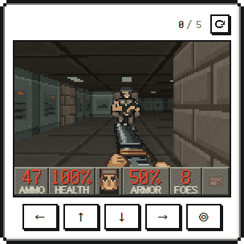</td>
    <td>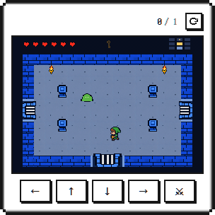</td>
  </tr>
  <tr><th>🏎️ Racing</th><th>🚀 Space shooter</th></tr>
  <tr>
    <td>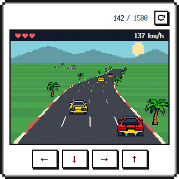</td>
    <td>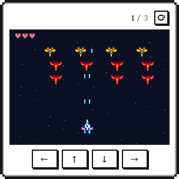</td>
  </tr>
  <tr><th>🧱 Tetris</th><th>🔢 2048</th></tr>
  <tr>
    <td>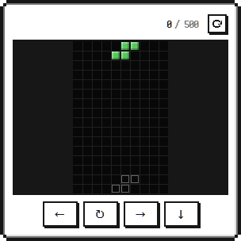</td>
    <td>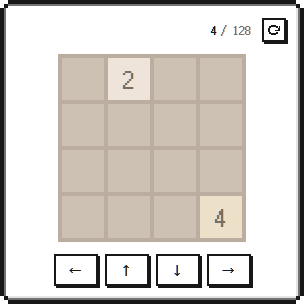</td>
  </tr>
  <tr><th>💣 Minesweeper</th><th>🎾 Breakout</th></tr>
  <tr>
    <td>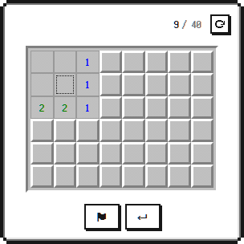</td>
    <td>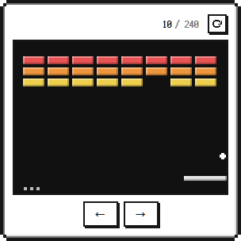</td>
  </tr>
  <tr><th>🐍 Snake</th><th>👻 Pac-Man</th></tr>
  <tr>
    <td>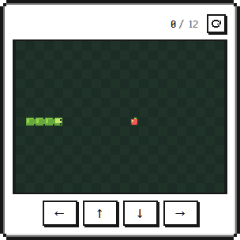</td>
    <td>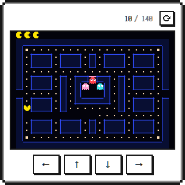</td>
  </tr>
  <tr><th>📦 Sokoban</th><th>🫧 Bubble shooter</th></tr>
  <tr>
    <td>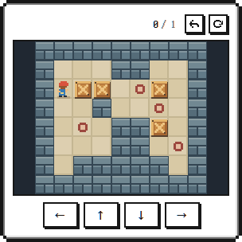</td>
    <td>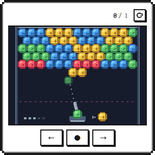</td>
  </tr>
</table>

Games: Tetris, 2048, Minesweeper, Breakout, FPS, Adventure, Racing, Snake, Space shooter, Pac-Man, Sokoban, and Bubble shooter.

> This is a frontend game gate for entertainment, not a bot-detection or authentication service. Completion events provide no security guarantee. Enforce real access permissions on your server.

## 🤖 AI integration prompt

Copy this block into your coding assistant:

```text
Integrate Arcade CAPTCHA into this project's existing login, submit, or entry flow. Implement the changes using the current framework and page structure.

Repository and API docs: https://github.com/superwyh/Arcade-CAPTCHA#readme
Demo: https://superwyh.github.io/Arcade-CAPTCHA/?view=login

With Git and Node.js 22.12+, run in a separate working directory:
git clone https://github.com/superwyh/Arcade-CAPTCHA.git arcade-captcha
cd arcade-captcha
npm ci
npm run build:lib

Copy the complete generated lib/ directory into this project's static assets, preserving chunks/, games/, fonts/, and licenses/. Load arcade-captcha.css and import createCaptcha from arcade-captcha.js using the actual deployment paths. Initialize only in the browser; no npm release is required.

Mount createCaptcha(container, { game: 'random', locale: 'auto', autoStart: true, onStateChange }). Use each game's default goal. Keep the pixel frame and immediate start.

Use onStateChange({ state }) to let the existing protected action continue only when state === 'passed'. Relock on retry and check gate.getSnapshot().state again before submission. Keep existing server authentication and validation. Call gate.destroy() on component or route cleanup.

Complete the implementation and verify passing, retrying, keyboard/touch controls, and the production build. Do not add unrelated UI or copy.
```

## 🏁 Run locally

Requires Node.js **22.12+** (the latest Node 22 LTS patch is recommended) and npm. If you already have the local source, start with `npm ci`.

```sh
git clone https://github.com/superwyh/Arcade-CAPTCHA.git arcade-captcha
cd arcade-captcha
npm ci
npm run dev
```

Open `http://127.0.0.1:4173/`. Both the development server and build preview use this fixed port and report an error if it is occupied.

On Windows, you can also double-click [`start-demo.cmd`](start-demo.cmd). It installs missing dependencies, starts the local server, and opens the browser. Keep the command window open while using the demo; close it to stop the server.

The playground includes:

- Direct switching between all 12 games, per-game targets, default settings, and random mode.
- A preview at the actual widget size, scores, and retries.
- Immediate play after loading or resetting; completion unlocks the page-entry button.
- JavaScript / HTML integration code and a copyable AI integration prompt based on the current settings. API options expand on demand.

Login demo is built into the main page: click **Login demo** or open `http://127.0.0.1:4173/?view=login`. It follows the page language. Sign in with the prefilled demo account to open a random game; consecutive openings never repeat. Passing completes a simulated login without sending or storing credentials. **Back to demo** restores your game and target settings.

## 🎮 Default rules

| Game ID | Game | Default goal | Scoring | Target range |
| --- | --- | --- | --- | --- |
| `tetris` | Tetris | 500 points | Clear 1 / 2 / 3 / 4 lines for 100 / 300 / 500 / 800 points | 1–10000 |
| `2048` | 2048 | 128 points | Merges add the resulting tile value; the goal is total score, not the largest tile | 1–10000 |
| `minesweeper` | Minesweeper | Reveal all 40 safe cells | Each revealed safe cell adds 1, including cells revealed by flood fill | 1–40 |
| `breakout` | Breakout | Clear all 24 bricks (240 points) | 10 points per brick; 24 bricks and three lives | 1–240 |
| `fps` | FPS | 5 sectors, about 5–7 minutes | Clear enemies, collect the red key, and reach the exit for 1; kills alone do not complete verification | 1–5 |
| `adventure` | Adventure | Complete 1 dungeon | Collect the key, defeat the guardian, and reach the exit stairs for 1 | 1–3 |
| `racing` | Racing | 1500 meters | Survive and cross the finish line | 1–10000 |
| `snake` | Snake | Eat 12 food items | Each food item adds 1 and grows the snake by one cell | 1–100 |
| `space` | Space shooter | 3 stages: two waves and a boss | Each cleared stage adds 1; the final stage is always a boss | 1–5 |
| `pacman` | Pac-Man | Collect all 140 pellets | Regular and power pellets each add 1; eating ghosts does not increase progress | 1–140 |
| `sokoban` | Sokoban | Complete 1 level | Progress increases only when every box reaches a goal; multiple levels can be required | 1–5 |
| `bubbles` | Bubble shooter | Clear 1 board | Progress increases only after clearing the entire board, not individual groups | 1–5 |

Minesweeper and Breakout require a full clear by default. Developers can set lower targets; verification then passes when `score >= targetScore`. For example, a Breakout target of 15 passes after two bricks. Minesweeper uses an 8×6 board with eight mines. The first click and its neighboring cells are safe, without revealing every safe cell immediately; blank areas expand using standard Minesweeper rules. Tetris uses a seven-bag randomizer containing all seven pieces in each bag.

Keyboard controls apply only inside the widget and do not take over page-wide arrow keys. Switching to a background tab pauses play automatically; returning resumes it. Buttons, swipes, clicks, and dragging support mobile play.

### FPS

Select `FPS` in the playground or open `/?game=fps`. Embed it with `game: 'fps'`. `targetScore` is the required number of completed sectors: 5 by default, configurable from 1 to 5. Every run and sector generates a new 25×25 map with 7–9 connected rooms, branches, loops, enemies, supplies, a key, and an exit.

Use W/S or Up/Down to move forward and backward; A/D or Left/Right to turn; Q/E to strafe. Moving the mouse over the game turns the camera; clicking enables pointer lock, and Esc releases it. Space, Enter, or clicking fires. Mobile supports drag-to-turn and directional/fire buttons. When ammunition runs out, close-range attacks remain available. Clear enemies and collect the red key to unlock the exit. Backgrounding, losing focus, retrying, and switching games release held inputs and pointer lock.

Uses Canvas raycasting and synthesized sound. Audio starts after the first interaction and is released when leaving the game.

### Adventure

Select Adventure or open `/?game=adventure`. Embed with `game: 'adventure'`; the default `targetScore: 1` can be set to 1–3 dungeons.

Nine connected rooms contain slimes, bats, skeletons, and a stone guardian. Defeating enemies opens doors and chests. Chests provide keys, sword upgrades, maximum-health increases, and healing. A key unlocks the guardian room; defeat the guardian and enter the stairs to finish. The minimap shows the current room and explored areas.

Move with WASD / arrow keys and attack with Space / J / Enter. Click or hold the game area to attack and drag to move; touch devices also have directional and attack buttons. Physical-key recognition and input release on focus loss are supported.

Assets: [character animation](src/assets/adventure-hero.png), [dungeon atlas](src/assets/adventure-dungeon.png), and [asset notes](src/assets/adventure-art.txt).

### Racing

Select Racing or open `/?game=racing`. Embed with `game: 'racing'`. The default goal is 1500 meters, configurable from 1 to 10000. The car advances automatically; three collisions end the run. Curves and traffic vary randomly. The default course takes about a minute.

Steer with A/D or Left/Right, brake with S/Down, and boost with W/Up/Space. Dragging and touch buttons are supported. Leaving the road slows the car; staying off-road for two seconds costs a life. Retrying generates a new course.

Assets: [vehicle atlas](src/assets/racing-atlas.png) and [asset notes](src/assets/racing-art.txt).

### Snake

Select Snake or open `/?game=snake`. Embed with `game: 'snake'`. The default `targetScore: 12` can be set to 1–100 food items. The snake moves automatically on a 22×16 board, growing and accelerating as it eats. Hitting a wall or itself ends the run. Food appears only in empty cells.

Turn with arrow keys, WASD, swipes, or touch buttons. Direct reversal is blocked, and consecutive turns execute in order. Physical keys work with a Chinese input method active. The classic green snake and red food are drawn with Canvas and require no image assets.

### Space shooter

Select Space shooter or open `/?game=space`. Embed with `game: 'space'`. The default `targetScore: 3` gives two enemy waves followed by a boss. Targets range from 1 to 5 stages, with a boss always last; setting 1 starts directly with the boss. Progress increases only after clearing an entire wave or defeating the boss.

Starts and fires automatically. Move with arrow keys, WASD, dragging, or touch buttons; physical keys work with Chinese input methods. The player has three lives and brief invulnerability after taking damage. Between stages, projectiles are cleared and one life is restored. Leaving releases inputs; retrying regenerates enemy attack timing.

Assets: [space shooter atlas](src/assets/space-atlas.png) and [asset notes](src/assets/space-art.txt).

### Pac-Man

Select Pac-Man or open `/?game=pacman`. Embed with `game: 'pacman'`. The default goal is all 140 pellets, including four power pellets; `targetScore` can be set to 1–140. Eating ghosts does not increase verification progress.

A 21×15 maze with three lives. Turn using arrow keys, WASD, swipes, or touch buttons. Turns can be queued, movement can be reversed, and the left/right tunnels connect. Power pellets grant seven seconds to eat ghosts, which then return to their spawn point. Collected pellets remain after taking damage, and respawning grants brief invulnerability. Retrying resets the maze.

### Sokoban

Select Sokoban or open `/?game=sokoban`. Embed with `game: 'sokoban'`. The default goal is one level; `targetScore` can require 1–5 consecutive levels. Five maps from the [Boxoban hard set](https://github.com/google-deepmind/boxoban-levels) each have four boxes, with minimum push counts of 27, 20, 21, 20, and 19. Solving them requires ordering pushes, moving boxes temporarily, and finding routes around them. Progress increases only when every box reaches a goal; movement, pushes, and undo do not score.

Move with arrow keys, WASD, swipes, or touch buttons. Z or the top undo icon reverses one move, including a push. Physical keys work with Chinese input methods. Push one box at a time; boxes cannot be pulled. Undo or retry when a box gets stuck. Completed levels advance automatically, and undo applies only to the current level. Retrying starts from the first level.

Levels come from the Apache 2.0-licensed Boxoban dataset published by Arthur Guez and collaborators. Only solid-wall borders were cropped, and two maps were transposed to fit the widget. Original levels, provenance, and the full license are in [third-party/boxoban/](third-party/boxoban/), distributed with builds under `lib/licenses/` and `dist/licenses/`.

### Bubble shooter

Select Bubble shooter or open `/?game=bubbles`. Embed with `game: 'bubbles'`. The default goal is one cleared board; `targetScore` can require 1–5 boards. Each board randomly arranges four bubble colors. Three or more connected bubbles of the same color pop together, and bubbles disconnected from the ceiling fall. Boards start with five rows and 63 bubbles, increasing to six rows from the third board.

Aim with the mouse, touch dragging, A/D, or Left/Right. Fire by clicking/releasing, pressing Space/Enter, or using the fire button. A dotted guide shows bounces and the landing position; the next bubble is previewed beside the launcher. Only colors remaining on the board are supplied, and only one bubble can be in flight. Five consecutive shots without a match lower the ceiling by one row; a match resets the counter. Reaching the bottom line ends the run. Retrying generates a new board and clears progress.

## Languages and fonts

The widget and playground match `navigator.languages` in priority order: Simplified Chinese, Traditional Chinese, English, Japanese, Korean, French, German, Spanish, and Portuguese. Unsupported languages fall back to English. `zh-Hant`, `zh-TW`, `zh-HK`, and `zh-MO` use Traditional Chinese; `zh-Hans` uses Simplified Chinese. Regional tags such as `fr-CA` and `pt-BR` match their base language.

Pass `locale: 'zh-TW'` or switch an instance with `reset({ locale: 'ja' })`. `getGames(locale)` returns localized game names. The playground accepts `?lang=ja` and other language tags; without one, it follows the browser.

Fusion Pixel 12px covers these languages and loads locally without a font CDN. It uses [SIL OFL 1.1](third-party/fusion-pixel/OFL.txt), permitting free use, commercial use, and redistribution. Keep the font and upstream licenses in `lib/licenses/`. Release: `v2026.11.10`, from [TakWolf/fusion-pixel-font](https://github.com/TakWolf/fusion-pixel-font). Font files live in `lib/fonts/` and deploy with the widget.

## Build and test

```sh
npm test            # Game rules and verification lifecycle tests
npm run typecheck   # TypeScript checks
npm run build       # Playground, distributable widget, and declarations
npm run preview     # Preview dist at http://127.0.0.1:4173
```

- `dist/`: static demo site, including `examples/basic.html` and its required `lib/`.
- `lib/arcade-captcha.js`: ES module widget.
- `lib/arcade-captcha.umd.cjs`: UMD build with the global name `ArcadeCaptcha`.
- `lib/arcade-captcha.css`: required widget styles.
- `lib/index.d.ts`: complete type declarations.

Build output is not committed to Git; CI rebuilds it. The widget does not depend on remote fonts, image CDNs, or a backend service.

## Embed in HTML

Clone from the repository URL above and run `npm ci` and `npm run build:lib`. Copy the complete `lib/` directory, including `fonts/` and `licenses/`, into your application's static assets. Paths below are relative to the HTML file; adjust them to your deployment. Serve over HTTP; ES modules cannot be loaded by double-clicking HTML with `file://`. See [`examples/basic.html`](examples/basic.html) for a runnable example at `/examples/basic.html` after `npm run dev`.

```html
<link rel="stylesheet" href="./lib/arcade-captcha.css" />
<div id="captcha"></div>
<button id="enter" disabled>Enter page</button>

<script type="module">
  import { createCaptcha } from './lib/arcade-captcha.js';

  const enter = document.querySelector('#enter');
  const gate = createCaptcha('#captcha', {
    game: 'tetris',
    targetScore: 500,
    onStateChange({ state }) {
      // Revoke previous completion when retrying or switching games.
      enter.disabled = state !== 'passed';
    },
    onVerify(result) {
      console.log(result.game, result.score, result.durationMs);
    },
  });

  enter.addEventListener('click', () => {
    if (gate.getSnapshot().state === 'passed') {
      // Replace with your URL; enforce real access permissions server-side.
      window.location.assign('./welcome.html');
    }
  });
</script>
```

## Embed in Vite / React / Vue

The package is not yet published to npm. After cloning and running `npm ci` and `npm run build:lib`, run `npm install /absolute/path/to/arcade-captcha` in the consuming project, replacing the path with your local clone. You can then import using the package name below. Alternatively, copy the complete `lib/` directory into static assets and follow the HTML example.

```ts
import { createCaptcha } from 'arcade-captcha';
import 'arcade-captcha/style.css';

const gate = createCaptcha(element, {
  game: 'random',
  targets: { tetris: 500, '2048': 128, minesweeper: 40, breakout: 240, fps: 5, adventure: 1, racing: 1500, snake: 12, space: 3, pacman: 140, sokoban: 1, bubbles: 1 },
  onVerify(result) {
    // Update completion state in your application.
  },
  onStateChange({ state }) {
    // Revoke completion when state !== 'passed'.
  },
});

// Call in React effect cleanup / Vue onBeforeUnmount:
gate.destroy();
```

In React, mount into `ref.current` inside `useEffect` and return `() => gate.destroy()`. In Vue, create the instance in `onMounted` and clean it up in `onBeforeUnmount`. Multiple independent instances can share a page.

### Import only the games you use

The default `arcade-captcha` entry still registers all twelve games. Use `arcade-captcha/core` with individual game entries to exclude unused games and their artwork:

```ts
import { createCaptcha, registerGame } from 'arcade-captcha/core';
import { tetrisGame } from 'arcade-captcha/games/tetris';
import 'arcade-captcha/style.css';

registerGame(tetrisGame);
const gate = createCaptcha(element, { game: 'tetris' });
```

Each game entry exports its existing definition, such as `tetrisGame`, `fpsGame`, or `mergeGame` from `arcade-captcha/games/2048`. Register each definition once before creating widgets. With this entry, `random` chooses only from registered games. Both entry styles share the same registry; avoid registering a built-in again after importing the full entry. For native HTML, use `./lib/core.js` and `./lib/games/tetris.js` and load the CSS separately. Keep the complete `lib/` directory, including `chunks/`, `games/`, `fonts/`, and `licenses/`.

Source artwork stays in `src/assets/`. Builds and tests run `npm run prepare:assets` to generate small runtime atlases with nearest-neighbor sampling. Do not edit the generated `src/assets/runtime/` files.

Install the browser once with `npx playwright install chromium`, then run `npm run test:browser`. This builds and tests the production site for narrow layouts, keyboard focus, modal cancellation, game switching and unchanged sprite pixels. Screenshots and traces go to `.qa/browser-results/`. To use an installed Chrome instead, set `PLAYWRIGHT_CHANNEL=chrome`.

### Configuration and lifecycle

| Option | Default | Description |
| --- | --- | --- |
| `game` | `'tetris'` | A registered game ID or `'random'` |
| `locale` | `'auto'` | Match the browser language, or pass a language tag such as `ja` or `fr-CA` |
| `autoStart` | `true` | Start immediately on mount, switch, and reset; set `false` for manual control |
| `targetScore` | Current game's default | A positive integer within the game's maximum target |
| `targets` | None | Per-game targets; take precedence over `targetScore` |
| `onVerify(result)` | None | Called at most once per round; play stops after passing |
| `onStateChange(snapshot)` | None | Called on state / score changes and during initialization |

`random` mode chooses from all registered games. Resetting draws again and may select the same game consecutively. Prefer `targets` for random mode; a shared `targetScore` must be valid for every candidate game or a `RangeError` is thrown.

Instance methods: `start()`, `pause()`, `resume()`, `reset(partialOptions?)`, `getSnapshot()`, and `destroy()`. Mounting enters `running` immediately by default, without a start button. Only `autoStart: false` leaves it in `idle`.

States: `idle → running → passed / failed`; `running ⇄ paused`. `reset()` clears progress and starts or waits according to `autoStart`. It merges supplied options; clear earlier values explicitly with `targetScore: undefined` or `targets: undefined`. `destroy()` removes animations, events, and DOM; the instance cannot be used afterward.

```ts
interface VerificationResult {
  game: string;
  score: number;
  targetScore: number;
  durationMs: number;   // Active play time, excluding pauses
  completedAt: string; // ISO 8601 timestamp
}

interface CaptchaSnapshot {
  state: 'idle' | 'running' | 'paused' | 'passed' | 'failed';
  game: string;
  score: number;
  targetScore: number;
}
```

### Add a game

Implement `GameDefinition` and call `registerGame(definition)`. See [`src/types.ts`](src/types.ts) for the full interface and [`src/games/`](src/games/) for existing implementations.

```ts
import { registerGame, type GameDefinition } from 'arcade-captcha';

const customGame: GameDefinition = {
  id: 'your-game',
  name: 'Your game',
  description: 'A short description',
  instructions: 'Controls',
  defaultTarget: 10,
  maxTarget: 100,
  scoreUnit: 'points',
  controls: [{ action: 'reveal', symbol: '↵', label: 'Perform action' }],
  create({ surface, reportScore, fail, announce }) {
    // Render the game inside surface.
    // reportScore(totalScore); fail('Reason'); announce('Status').
    return {
      start() {},
      pause() {},
      resume() {},
      action(action) {},
      destroy() {},
    };
  },
};
registerGame(customGame);
```

Custom games must implement pausing and cleanup correctly; they do not directly grant access. The framework validates targets, fires a single completion callback, and isolates stale sessions. Registering a duplicate ID throws an error. Real-time games can define bindings through `GameDefinition.keys` and implement the optional `setInput(action, pressed)` session method for held/released inputs. The framework releases keys on focus loss, pause, and reset. Games without this method continue using `action()`.

## GitHub and deployment

Repository: `https://github.com/superwyh/Arcade-CAPTCHA`; Pages: `https://superwyh.github.io/Arcade-CAPTCHA/`. Vite uses relative asset paths with `base: './'`, supporting both root sites and `https://<user>.github.io/<repository>/` without hardcoding a repository name.

1. Push the source and `package-lock.json` to the `main` or `master` branch on GitHub.
2. Set **Settings → Pages → Build and deployment → Source** to **GitHub Actions**.
3. Push code or manually run **Deploy demo to GitHub Pages** in Actions.
4. The workflow installs dependencies, runs tests and type checks, builds, and deploys `dist/` to Pages.
5. Find the deployed URL in the workflow's `github-pages` environment. Enable Pages in repository settings before the first deployment.

`.github/workflows/ci.yml` checks pull requests. `pages.yml` deploys on pushes to `main` or `master`, or on a manual run; pull requests do not deploy directly. The deployment job uses only the necessary Pages and OIDC permissions. No database, API key, or additional secrets are required.

License: [MIT](LICENSE). Contributing: [CONTRIBUTING.md](CONTRIBUTING.md). Security boundaries: [SECURITY.md](SECURITY.md).

## Project layout

```text
src/core.ts            Registry, lifecycle, targets, and verification callbacks
src/types.ts           Game extension and public API types
src/games/             Independent logic and rendering for all 12 games
src/style.css          Standalone embeddable widget styles
demo/                  Configuration playground and demo welcome page
examples/basic.html    Minimal HTML integration example
tests/                 Game rules and framework regression tests
.github/workflows/     CI and GitHub Pages deployment
```
