# 🕹️ Arcade CAPTCHA

[English](README.md) · 简体中文 · [日本語](README.ja.md) · [한국어](README.ko.md)

通过玩小游戏完成验证码。内置 12 款像素游戏，支持自定义通关目标、随机游戏和九种语言。原生 TypeScript，零运行时依赖，可嵌入 HTML、React、Vue 页面。

[GitHub](https://github.com/superwyh/Arcade-CAPTCHA) · [演示](https://superwyh.github.io/Arcade-CAPTCHA/)

<table>
  <tr><th>🎯 FPS</th><th>⚔️ 冒险</th></tr>
  <tr>
    <td>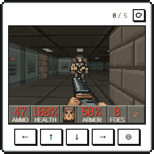</td>
    <td>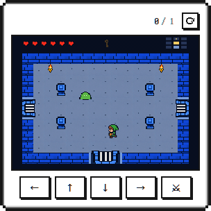</td>
  </tr>
  <tr><th>🏎️ 赛车</th><th>🚀 太空射击</th></tr>
  <tr>
    <td>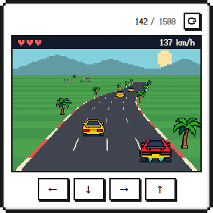</td>
    <td>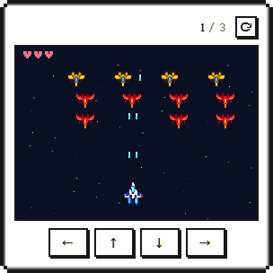</td>
  </tr>
  <tr><th>🧱 俄罗斯方块</th><th>🔢 2048</th></tr>
  <tr>
    <td>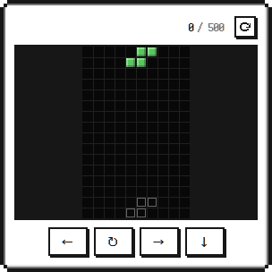</td>
    <td>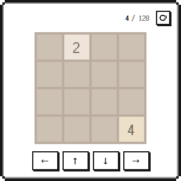</td>
  </tr>
  <tr><th>💣 扫雷</th><th>🎾 打砖块</th></tr>
  <tr>
    <td>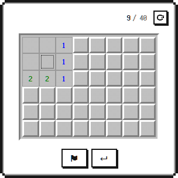</td>
    <td>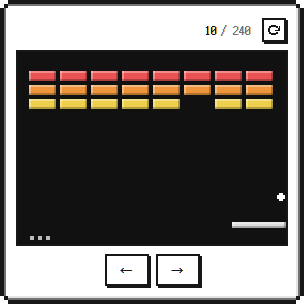</td>
  </tr>
  <tr><th>🐍 贪吃蛇</th><th>👻 吃豆人</th></tr>
  <tr>
    <td>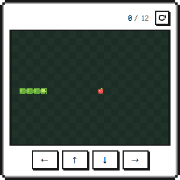</td>
    <td>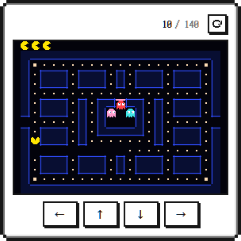</td>
  </tr>
  <tr><th>📦 推箱子</th><th>🫧 泡泡龙</th></tr>
  <tr>
    <td>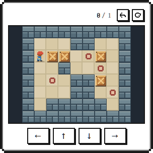</td>
    <td>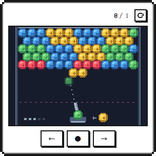</td>
  </tr>
</table>

全部游戏：俄罗斯方块、2048、扫雷、打砖块、FPS、冒险、赛车、贪吃蛇、太空射击、吃豆人、推箱子、泡泡龙。

> 这是娱乐用途的前端门槛，不是反机器人或身份验证服务。通关事件不提供安全担保，真正的访问权限须由业务服务端控制。

## 🤖 AI 接入提示词

复制下面整段给编程助手：

```text
把 Arcade CAPTCHA 接入当前项目的登录、提交或进入流程。沿用现有框架和页面结构，直接完成代码修改。

仓库与 API 文档：https://github.com/superwyh/Arcade-CAPTCHA#readme
演示：https://superwyh.github.io/Arcade-CAPTCHA/?view=login

使用 Git 和 Node.js 22.12+，在单独的工作目录执行：
git clone https://github.com/superwyh/Arcade-CAPTCHA.git arcade-captcha
cd arcade-captcha
npm ci
npm run build:lib

将生成的 lib/ 完整复制到当前项目的静态资源目录，保留 chunks/、games/、fonts/ 和 licenses/。按实际部署路径加载 arcade-captcha.css，并从 arcade-captcha.js 导入 createCaptcha；仅在浏览器端初始化，不依赖 npm 发布。

挂载 createCaptcha(container, { game: 'random', locale: 'auto', autoStart: true, onStateChange })。采用每款游戏的默认目标，保留像素框体和直接开始。

通过 onStateChange({ state }) 让现有操作仅在 state === 'passed' 后继续；重试时重新锁定，提交前再次检查 gate.getSnapshot().state。保留现有服务端鉴权和校验，组件或路由卸载时调用 gate.destroy()。

完成接入，并验证通关、重试、键盘/触屏操作及生产构建。不要添加无关界面或文案。
```

## 🏁 本地启动

需要 Node.js **22.12+**（建议 Node 22 最新 LTS 补丁版）及 npm。已有本地源码时从 `npm ci` 开始。

```sh
git clone https://github.com/superwyh/Arcade-CAPTCHA.git arcade-captcha
cd arcade-captcha
npm ci
npm run dev
```

打开 `http://127.0.0.1:4173/`。开发服务和构建预览固定使用此端口，端口被占用时会报错，不会改用其他地址。测试台支持：

Windows 也可以双击 [`start-demo.cmd`](start-demo.cmd)，它会在缺少依赖时安装依赖，随后启动本地服务并打开浏览器。体验期间保持命令窗口开启，关闭窗口即可停止服务。

- 十二种游戏切换、独立目标设置、恢复默认、随机模式。
- 实际尺寸预览、得分与重试。
- 游戏加载与重置后直接开始，达标后解锁“进入页面”。
- 根据当前设置生成 JavaScript / HTML 接入代码和可复制的 AI 接入提示词；API 参数按需展开。

登录演示已内置在主页面：点击**登录演示**，或打开 `http://127.0.0.1:4173/?view=login`，语言与当前页面一致。使用预填的演示账号登录，每次弹出随机游戏，相邻两次不重复；通关后完成模拟登录，不发送或保存账号密码。点击**返回测试**可恢复之前的游戏和目标设置。

## 🎮 默认规则

| 游戏 ID | 游戏 | 默认目标 | 计分方式 | 可配置范围 |
| --- | --- | --- | --- | --- |
| `tetris` | 俄罗斯方块 | 500 分 | 一次消除 1 / 2 / 3 / 4 行得 100 / 300 / 500 / 800 分 | 1–10000 |
| `2048` | 2048 | 128 分 | 合并时增加合成数字的值；目标是累计得分，不是最大方块 | 1–10000 |
| `minesweeper` | 扫雷 | 清屏：全部 40 个安全格 | 每翻开一个安全格得 1 分，空白区域展开也计入 | 1–40 |
| `breakout` | 打砖块 | 清屏：全部 24 块砖（240） | 每块砖 10 分，共 24 块砖、3 次接球机会 | 1–240 |
| `fps` | 第一人称射击 | 5 关，预计约 5–7 分钟 | 每关清敌、拿到红钥匙并进入出口计 1；杀敌本身不放行 | 1–5 |
| `adventure` | 冒险 | 通关 1 座地下城 | 取得钥匙、击败守卫并走到出口楼梯后计 1 | 1–3 |
| `racing` | 赛车 | 1500 米 | 存活并驶过终点 | 1–10000 |
| `snake` | 贪吃蛇 | 12 个食物 | 每吃一个食物计 1，蛇身增长一格 | 1–100 |
| `space` | 太空射击 | 3 阶段：两波敌机＋Boss | 清空一个阶段计 1，最终阶段固定为 Boss | 1–5 |
| `pacman` | 吃豆人 | 清空全部 140 颗豆子 | 普通豆和能量豆各计 1；吃幽灵不增加通关进度 | 1–140 |
| `sokoban` | 推箱子 | 完成 1 关 | 全部箱子就位才计 1；可连续完成不同关卡 | 1–5 |
| `bubbles` | 泡泡龙 | 清空 1 屏 | 清空整屏才计 1；单次消除不放行 | 1–5 |

默认扫雷须翻开全部安全格，打砖块须消除全部砖块。开发者仍可配置较低的目标，此时 `score >= targetScore` 即通过。例如打砖块设为 15 分时，击碎两块砖即通过。扫雷采用 8×6 棋盘和 8 个雷，首次点击及相邻格保证安全，开局不会直接翻完所有安全格；按标准扫雷规则展开空白区域。俄罗斯方块使用七袋随机，每袋含全部七种方块。

键盘操作仅在组件内生效，不占用整页方向键。切换到后台标签页时自动暂停，回来后自动继续。按钮、滑动、点击或拖动支持手机操作。

### FPS

测试台选择 `FPS`，或打开 `/?game=fps`。使用 `game: 'fps'` 接入；`targetScore` 为需要完成的关卡数，默认 5，可设为 1–5。每局及每关随机生成 25×25 地图，包含 7–9 个相连房间、岔路和环路，随机安排敌人、补给、钥匙与出口。

W/S 或上下方向键前进、后退；A/D 或左右方向键转向；Q/E 平移。鼠标在画面内移动即可转向，点击后支持鼠标锁定，Esc 释放；空格、回车或点击射击。手机支持拖动转向及下方方向、射击按钮。弹药用尽后可以近身攻击。清敌并拿到红钥匙后开启出口；后台、失焦、重试和切换游戏会释放持续输入及鼠标锁定。

使用 Canvas 射线投射和合成音效。音效在首次操作后启用，离开游戏时释放。

### 冒险

测试台选择“冒险”，或打开 `/?game=adventure`。接入参数为 `game: 'adventure'`，默认 `targetScore: 1`，可设置为 1–3 座地下城。

九个相连房间，包含史莱姆、蝙蝠、骷髅和石像守卫。清敌后打开房门和宝箱，宝箱可提供钥匙、剑强化、生命上限及治疗。钥匙开启守卫房；击败守卫后走入楼梯才通关。小地图显示当前房间及已探索区域。

WASD / 方向键移动，空格 / J / 回车攻击；点击或按住画面攻击，拖动移动；触屏也可使用下方方向及攻击按钮。使用已有的实体键识别和失焦释放机制。

素材：[角色动画](src/assets/adventure-hero.png)、[地下城图集](src/assets/adventure-dungeon.png)、[素材说明](src/assets/adventure-art.txt)。

### 赛车

测试台选择“赛车”，或打开 `/?game=racing`。接入参数 `game: 'racing'`，默认目标 1500 米，可配置为 1–10000 米。自动前进，三次碰撞后失败；弯道、交通车辆随机变化，约一分钟完成默认赛程。

A/D 或左右键转向，S/下键刹车，W/上键/空格加速；支持画面拖动和触屏按钮。驶离公路会减速，持续两秒会损失一次机会。重试重新生成赛道。

素材：[车辆图集](src/assets/racing-atlas.png)、[素材说明](src/assets/racing-art.txt)。

### 贪吃蛇

测试台选择“贪吃蛇”，或打开 `/?game=snake`。接入参数 `game: 'snake'`，默认 `targetScore: 12`，可配置为 1–100 个食物。22×16 棋盘，自动前进，吃食物后变长并逐渐加速，撞墙或自身结束。食物只生成在空格。

方向键、WASD、画面滑动或触屏方向按钮转向，不能直接掉头；连续转向按顺序执行。支持中文输入法下的实体按键。经典绿色像素蛇与红色食物由 Canvas 绘制，无额外图片依赖。

### 太空射击

选择“太空射击”或打开 `/?game=space`，使用 `game: 'space'` 接入。默认 `targetScore: 3`，两波敌机后挑战 Boss；可配置 1–5 个阶段，最后一个阶段始终为 Boss，设为 1 时直接挑战 Boss。消灭一整波敌机或击败 Boss 才增加进度。

自动开始并连续射击。方向键、WASD、拖动或触屏按钮移动，中文输入法下使用实体按键。三条生命，受击后短暂无敌；阶段间清除弹幕并恢复一条生命。离开游戏时释放输入，重试重新生成敌机的攻击节奏。

素材：[太空射击图集](src/assets/space-atlas.png)、[素材说明](src/assets/space-art.txt)。

### 吃豆人

选择“吃豆人”或打开 `/?game=pacman`，使用 `game: 'pacman'` 接入。默认目标为清空迷宫的全部 140 颗豆子（含 4 颗能量豆）；`targetScore` 可设置为 1–140。吃幽灵不增加验证进度。

21×15 迷宫，三条生命。方向键、WASD、画面滑动或触屏方向按钮转向，支持提前输入拐弯和行进中掉头；左右隧道互通。能量豆提供 7 秒反击时间，幽灵被吃后回到出生点。受击后保留已吃的豆子，重生期间短暂无敌；重试重新开始整张地图。

### 推箱子

选择“推箱子”或打开 `/?game=sokoban`，使用 `game: 'sokoban'` 接入。默认完成 1 关，可用 `targetScore` 配置为连续完成 1–5 关。内置五张 [Boxoban 困难集](https://github.com/google-deepmind/boxoban-levels)地图，每关四个箱子，最少推箱次数分别为 27、20、21、20、19；需要安排推箱顺序、临时挪箱和绕行。全部箱子到达目标点才增加进度；走动、推箱和撤销本身不计分。

方向键、WASD、滑动或触屏方向按钮移动，Z 或顶部撤销图标退回一步（包括推箱），支持中文输入法实体按键。箱子只能推、不能拉，一次只能推动一个；推入死角可以撤销或重试。关卡完成后自动进入下一关，撤销只作用于当前关；重试从第一关重新开始。

关卡来自 Arthur Guez 等人发布的 Boxoban 数据集，使用 Apache 2.0 许可；仅裁掉纯墙边缘并转置两张地图以适配原尺寸。原始关卡、来源和完整许可保存在 [third-party/boxoban/](third-party/boxoban/)，构建时随 `lib/licenses/` 和 `dist/licenses/` 分发。

### 泡泡龙

选择“泡泡龙”或打开 `/?game=bubbles`，使用 `game: 'bubbles'` 接入。默认清空 1 屏，可用 `targetScore` 配置为连续清空 1–5 屏。每屏随机排列四色泡泡，三个或以上相连的同色泡泡触发整组消除；失去顶部支撑的泡泡一同掉落。初始为五行 63 个泡泡，第三屏起增加至六行。

鼠标移动、触屏拖动、A/D 或左右键瞄准，点击／松手、空格、回车或射击按钮发射。瞄准虚线显示反弹路径及落点，旁边预览下一颗；仅提供场上仍存在的颜色，一次只有一颗在飞行。连续五次未消除后顶部下降一格，成功消除会重置计数；泡泡触及底线时失败。重试重新生成棋盘并清空进度。

## 多语言与字体

组件和测试台自动按 `navigator.languages` 的优先顺序匹配简体中文、繁体中文、英文、日文、韩文、法文、德语、西班牙语、葡萄牙语；不支持的语言回退到英文。`zh-Hant`、`zh-TW`、`zh-HK`、`zh-MO` 使用繁体，`zh-Hans` 使用简体；`fr-CA`、`pt-BR` 等地区标签匹配对应语言。

开发者可传入 `locale: 'zh-TW'`，也可通过 `reset({ locale: 'ja' })` 切换实例语言。`getGames(locale)` 返回对应语言的游戏名称。测试台可通过 `?lang=ja` 等参数预览语言，不指定时跟随浏览器。

Fusion Pixel 12px 覆盖上述语言，随项目本地加载，无需访问字体 CDN。字体使用 [SIL OFL 1.1](third-party/fusion-pixel/OFL.txt)，可以免费使用、商用和随项目分发；保留 `lib/licenses/` 内的字体及上游授权。发布版本：`v2026.11.10`，来源：[TakWolf/fusion-pixel-font](https://github.com/TakWolf/fusion-pixel-font)。字体文件位于 `lib/fonts/`，与组件一同部署。

## 构建与测试

```sh
npm test            # 规则和验证生命周期测试
npm run typecheck   # TypeScript 检查
npm run build       # 测试台 + 可分发组件 + 类型声明
npm run preview     # 预览 dist，通常为 http://127.0.0.1:4173
```

- `dist/`：可静态部署的测试站点，包含 `examples/basic.html` 与它需要的 `lib/`。
- `lib/arcade-captcha.js`：ES Module 组件。
- `lib/arcade-captcha.umd.cjs`：UMD 构建，全局名称 `ArcadeCaptcha`。
- `lib/arcade-captcha.css`：必须同时加载的组件样式。
- `lib/index.d.ts`：完整类型声明。

构建产物不提交 Git，由 CI 重建。组件不依赖网络字体、图片 CDN 或后端服务。

## 接入普通 HTML

先按上面的 GitHub 地址克隆仓库并运行 `npm ci`、`npm run build:lib`，把完整 `lib/`（包含 `fonts/`、`licenses/`）复制到接入项目的静态资源目录。下面路径按 HTML 所在目录解析，可按实际部署位置调整。用 HTTP 服务访问，不能直接双击 HTML 以 `file://` 打开 ES Module。完整可运行示例见 [`examples/basic.html`](examples/basic.html)：运行 `npm run dev` 后访问 `/examples/basic.html`。

```html
<link rel="stylesheet" href="./lib/arcade-captcha.css" />
<div id="captcha"></div>
<button id="enter" disabled>进入页面</button>

<script type="module">
  import { createCaptcha } from './lib/arcade-captcha.js';

  const enter = document.querySelector('#enter');
  const gate = createCaptcha('#captcha', {
    game: 'tetris',
    targetScore: 500,
    onStateChange({ state }) {
      // 重试 / 更换游戏时撤销上次的通行状态。
      enter.disabled = state !== 'passed';
    },
    onVerify(result) {
      console.log(result.game, result.score, result.durationMs);
    },
  });

  enter.addEventListener('click', () => {
    if (gate.getSnapshot().state === 'passed') {
      // 替换为你的页面地址；它仍需由业务端控制真正的访问权限。
      window.location.assign('./welcome.html');
    }
  });
</script>
```

## 在 Vite / React / Vue 中接入

当前未发布 npm 包。按上面的地址克隆并完成 `npm ci`、`npm run build:lib` 后，在消费项目执行 `npm install /absolute/path/to/arcade-captcha`（替换为本地克隆目录），即可使用下面的包名导入。也可将完整 `lib/` 放入静态目录，按 HTML 示例加载。

```ts
import { createCaptcha } from 'arcade-captcha';
import 'arcade-captcha/style.css';

const gate = createCaptcha(element, {
  game: 'random',
  targets: { tetris: 500, '2048': 128, minesweeper: 40, breakout: 240, fps: 5, adventure: 1, racing: 1500, snake: 12, space: 3, pacman: 140, sokoban: 1, bubbles: 1 },
  onVerify(result) {
    // 更新你应用中的通行状态。
  },
  onStateChange({ state }) {
    // state !== 'passed' 时撤销通行状态。
  },
});

// React effect cleanup / Vue onBeforeUnmount 中调用：
gate.destroy();
```

React 中在 `useEffect` 挂载到 `ref.current`，返回 `() => gate.destroy()`；Vue 在 `onMounted` 创建，在 `onBeforeUnmount` 清理。单页可同时使用多个独立实例。

### 只导入需要的游戏

默认 `arcade-captcha` 入口仍注册全部十二款游戏。使用 `arcade-captcha/core` 和单独的游戏入口，可以排除未使用的游戏及其素材：

```ts
import { createCaptcha, registerGame } from 'arcade-captcha/core';
import { tetrisGame } from 'arcade-captcha/games/tetris';
import 'arcade-captcha/style.css';

registerGame(tetrisGame);
const gate = createCaptcha(element, { game: 'tetris' });
```

各游戏入口导出原有定义，例如 `tetrisGame`、`fpsGame`；2048 从 `arcade-captcha/games/2048` 导出 `mergeGame`。创建组件前，每种游戏注册一次。此时 `random` 只从已注册的游戏中选择。两种入口共用注册表，导入全量入口后不要重复注册内置游戏。普通 HTML 可改为导入 `./lib/core.js` 和 `./lib/games/tetris.js`，样式仍单独加载。保留完整 `lib/`，包括 `chunks/`、`games/`、`fonts/` 和 `licenses/`。

原始素材保留在 `src/assets/`。构建和测试自动执行 `npm run prepare:assets`，使用最近邻采样生成小尺寸图集；不要直接编辑生成的 `src/assets/runtime/` 文件。

首次运行 `npx playwright install chromium` 安装测试浏览器，再运行 `npm run test:browser`。该命令包含生产构建，检查窄屏、键盘焦点、弹窗取消、游戏切换及图集像素一致性。截图与 trace 位于 `.qa/browser-results/`。如需使用已安装的 Chrome，设置环境变量 `PLAYWRIGHT_CHANNEL=chrome`。

### 配置与生命周期

| 配置 | 默认值 | 说明 |
| --- | --- | --- |
| `game` | `'tetris'` | 已注册的游戏 ID，或 `'random'` |
| `locale` | `'auto'` | 自动匹配浏览器语言；也可传入语言标签，如 `ja`、`fr-CA` |
| `autoStart` | `true` | 挂载、切换和重置后立即开始；传 `false` 可手动控制 |
| `targetScore` | 当前游戏默认值 | 正整数；不能超过该游戏最大目标 |
| `targets` | 无 | 按游戏设置目标，优先级高于 `targetScore` |
| `onVerify(result)` | 无 | 每局最多触发一次，通过后游戏停止 |
| `onStateChange(snapshot)` | 无 | 状态 / 得分变化时触发，也会在初始化时触发 |

`random` 模式从所有已注册游戏中选择，重置会重新抽取，可能连续抽到同一种。随机模式推荐使用 `targets`；共用的 `targetScore` 必须对所有候选游戏有效，否则会抛出 `RangeError`。

实例方法：`start()`、`pause()`、`resume()`、`reset(partialOptions?)`、`getSnapshot()`、`destroy()`。默认挂载后立即进入 `running`，无需开始按钮；配置 `autoStart: false` 时才停留在 `idle`。

状态流转：`idle → running → passed / failed`；`running ⇄ paused`。`reset()` 清空本局进度并按 `autoStart` 配置立即开始或等待。`reset()` 合并传入选项；要清除原配置，可显式传入 `targetScore: undefined` 或 `targets: undefined`。`destroy()` 清理动画、事件和 DOM，此后实例不再工作。

```ts
interface VerificationResult {
  game: string;
  score: number;
  targetScore: number;
  durationMs: number;   // 有效游戏时长，不含暂停
  completedAt: string; // ISO 8601 时间
}

interface CaptchaSnapshot {
  state: 'idle' | 'running' | 'paused' | 'passed' | 'failed';
  game: string;
  score: number;
  targetScore: number;
}
```

### 扩展新游戏

实现 `GameDefinition` 并调用 `registerGame(definition)`。完整接口在 [`src/types.ts`](src/types.ts)，现有游戏在 [`src/games/`](src/games/)。

```ts
import { registerGame, type GameDefinition } from 'arcade-captcha';

const customGame: GameDefinition = {
  id: 'your-game',
  name: '你的游戏',
  description: '一句话介绍',
  instructions: '操作方法',
  defaultTarget: 10,
  maxTarget: 100,
  scoreUnit: '分',
  controls: [{ action: 'reveal', symbol: '↵', label: '执行动作' }],
  create({ surface, reportScore, fail, announce }) {
    // 在 surface 内绘制游戏。
    // reportScore(累计分数)；fail('失败原因')；announce('操作提示')。
    return {
      start() {},
      pause() {},
      resume() {},
      action(action) {},
      destroy() {},
    };
  },
};
registerGame(customGame);
```

扩展游戏负责正确实现暂停与资源释放，不直接决定放行。框架统一校验目标、单次通过回调与过期会话隔离。重复注册同名游戏会报错。实时游戏可通过 `GameDefinition.keys` 配置按键，并在会话实现可选的 `setInput(action, pressed)` 接收按住、释放事件；框架在失焦、暂停和重置时释放按键，未实现此方法的游戏继续使用原有 `action()`。

## GitHub 开源与部署

仓库地址：`https://github.com/superwyh/Arcade-CAPTCHA`；Pages 地址：`https://superwyh.github.io/Arcade-CAPTCHA/`。Vite 使用相对资源路径 `base: './'`，同时适配根站点与 `https://<user>.github.io/<repository>/` 项目站点，无需写死仓库名。

1. 将源码及 `package-lock.json` 推送至 GitHub 的 `main` 或 `master` 分支。
2. 仓库 **Settings → Pages → Build and deployment → Source** 选择 **GitHub Actions**。
3. 推送代码，或在 Actions 中手动运行 **Deploy demo to GitHub Pages**。
4. 工作流执行依赖安装、测试、类型检查与构建，随后将 `dist/` 部署到 Pages。
5. 部署成功后的网址见工作流环境 `github-pages`。首次部署需在仓库设置中启用 Pages。

`.github/workflows/ci.yml` 检查 PR；`pages.yml` 仅在默认分支推送或手动执行时部署，不把 PR 直接发布。部署作业仅授予 Pages 与 OIDC 必需权限。无需数据库、API key 或额外 Secrets。

协议：[MIT](LICENSE)。贡献规范：[CONTRIBUTING.md](CONTRIBUTING.md)。安全边界：[SECURITY.md](SECURITY.md)。

## 目录

```text
src/core.ts            注册、生命周期、目标判定、通关回调
src/types.ts           游戏扩展与公共 API 类型
src/games/            十二种游戏的独立逻辑与渲染
src/style.css         可嵌入组件的独立样式
demo/                 配置测试台与演示欢迎页
examples/basic.html   最小 HTML 接入示例
tests/                游戏规则与框架回归测试
.github/workflows/    CI 与 GitHub Pages 部署
```
